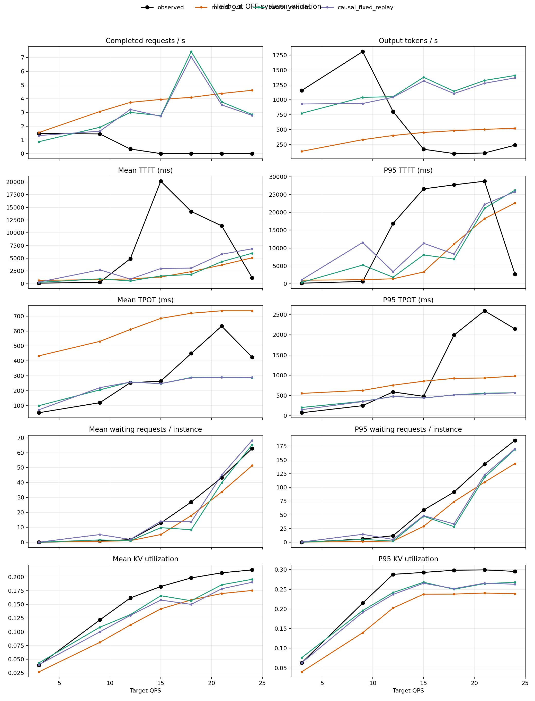
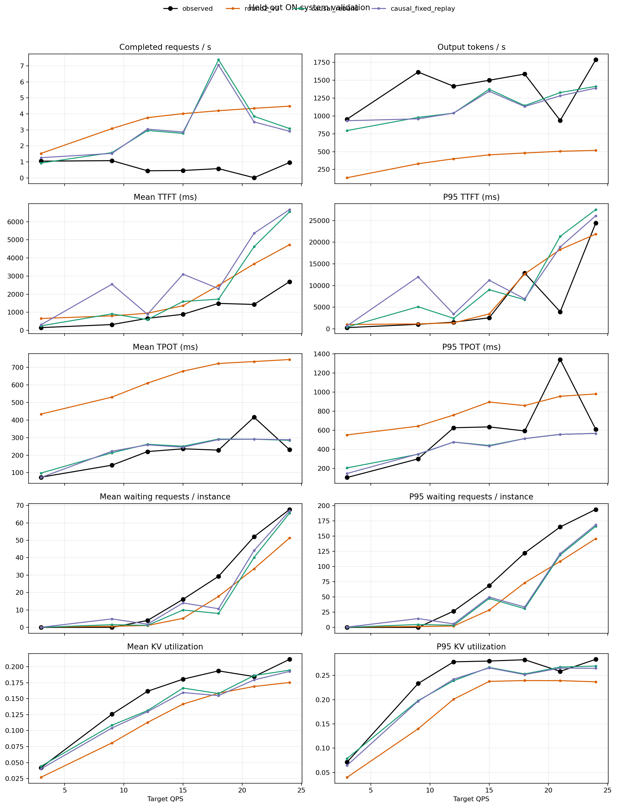
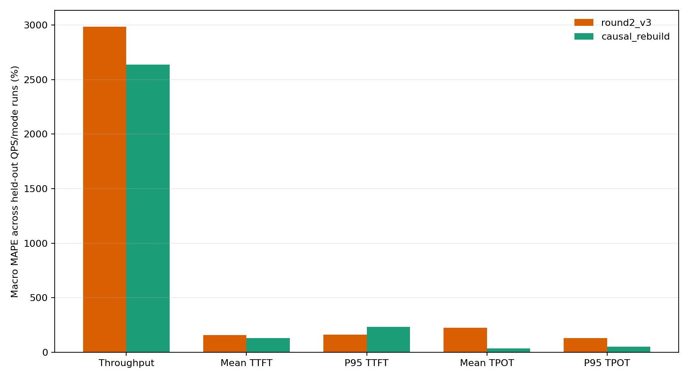

# Causal system validation

Training seed(s): [606, 909]; held-out seed: 1213. 
Measurement/drain: 60s / 30s. 
The predictive simulator receives held-out measurement arrivals, prompt lengths, and budgets only.

## Held-out error summary

| Version | Metric | Macro MAPE | Macro MAE | Signed bias |
|:---|:---|---:|---:|---:|
| round2_v3 | request_throughput_rps | 2985.07% | 3.069 | 3.069 |
| round2_v3 | output_tokens_per_sec | 126.22% | 801.285 | -608.620 |
| round2_v3 | ttft_mean_ms | 157.85% | 3876.125 | -2165.274 |
| round2_v3 | ttft_p95_ms | 163.55% | 7577.998 | -2243.468 |
| round2_v3 | tpot_mean_ms | 224.83% | 368.456 | 368.456 |
| round2_v3 | tpot_p95_ms | 128.85% | 535.781 | -76.457 |
| round2_v3 | queue_mean_requests | 347.84% | 7.141 | -7.002 |
| round2_v3 | queue_p95_requests | 47.35% | 25.500 | -25.143 |
| round2_v3 | kv_mean_fraction | 24.32% | 0.035 | -0.035 |
| round2_v3 | kv_p95_fraction | 24.63% | 0.055 | -0.055 |
| causal_rebuild | request_throughput_rps | 2637.23% | 2.769 | 2.667 |
| causal_rebuild | output_tokens_per_sec | 265.07% | 610.898 | 144.624 |
| causal_rebuild | ttft_mean_ms | 130.66% | 4055.493 | -2011.310 |
| causal_rebuild | ttft_p95_ms | 232.53% | 9187.327 | -545.734 |
| causal_rebuild | tpot_mean_ms | 34.22% | 84.875 | -26.918 |
| causal_rebuild | tpot_p95_ms | 51.21% | 492.055 | -436.935 |
| causal_rebuild | queue_mean_requests | 801.53% | 5.355 | -4.675 |
| causal_rebuild | queue_p95_requests | 40.19% | 24.283 | -23.533 |
| causal_rebuild | kv_mean_fraction | 11.58% | 0.019 | -0.018 |
| causal_rebuild | kv_p95_fraction | 11.04% | 0.026 | -0.022 |
| causal_rebuild | migration_total_mean_ms | 30.48% | 282.086 | -230.382 |
| causal_rebuild | migration_pause_stage_mean_ms | 51.28% | 243.023 | -243.023 |
| causal_rebuild | migration_recovery_mean_ms | 15753.79% | 20648.396 | 20648.396 |
| causal_fixed_replay | request_throughput_rps | 2425.37% | 2.636 | 2.614 |
| causal_fixed_replay | output_tokens_per_sec | 253.60% | 585.949 | 134.851 |
| causal_fixed_replay | ttft_mean_ms | 239.56% | 4264.993 | -1140.633 |
| causal_fixed_replay | ttft_p95_ms | 391.73% | 9584.467 | 928.078 |
| causal_fixed_replay | tpot_mean_ms | 29.40% | 82.393 | -29.740 |
| causal_fixed_replay | tpot_p95_ms | 41.97% | 485.388 | -446.890 |
| causal_fixed_replay | queue_mean_requests | 2490.50% | 4.464 | -1.938 |
| causal_fixed_replay | queue_p95_requests | 47.18% | 23.677 | -20.246 |
| causal_fixed_replay | kv_mean_fraction | 13.39% | 0.023 | -0.023 |
| causal_fixed_replay | kv_p95_fraction | 9.93% | 0.026 | -0.025 |
| causal_fixed_replay | migration_total_mean_ms | 16.79% | 165.934 | -92.443 |
| causal_fixed_replay | migration_pause_stage_mean_ms | 20.95% | 179.101 | -157.462 |
| causal_fixed_replay | migration_recovery_mean_ms | 25.00% | 62.110 | -56.774 |

## Warmup phase boundary

| Mode | QPS | HTTP 200 | HTTP 499 | Migrations started | In flight at measurement start |
|:---:|---:|---:|---:|---:|---:|
| off | 12 | 187 | 0 | 0 | 0 |
| off | 15 | 44 | 175 | 0 | 0 |
| off | 18 | 73 | 217 | 0 | 0 |
| off | 21 | 113 | 196 | 0 | 0 |
| off | 24 | 78 | 276 | 0 | 0 |
| off | 3 | 34 | 0 | 0 | 0 |
| off | 9 | 134 | 0 | 0 | 0 |
| on | 12 | 187 | 0 | 4 | 0 |
| on | 15 | 219 | 0 | 1 | 0 |
| on | 18 | 290 | 0 | 2 | 0 |
| on | 21 | 309 | 0 | 2 | 0 |
| on | 24 | 354 | 0 | 1 | 0 |
| on | 3 | 34 | 0 | 4 | 0 |
| on | 9 | 134 | 0 | 1 | 0 |

## Output delivery and first-token coverage

Engine-to-API callback lag is measured by joining request ID and cumulative output-token count. It is an observational diagnostic and is not supplied to the simulator.

| Mode | QPS | Engine updates | API updates | Matched | First-output lag p50/p95 ms | First-token events in window / sent | Right-censored at window |
|:---:|---:|---:|---:|---:|---:|---:|---:|
| off | 12 | 298159 | 126840 | 126840 | 471.1/46059.9 | 319/690 | 371 |
| off | 15 | 280348 | 29065 | 29065 | 23502.0/85907.9 | 128/892 | 764 |
| off | 18 | 301370 | 29031 | 29031 | 6551.7/35195.9 | 98/1095 | 997 |
| off | 21 | 300754 | 25893 | 25893 | 5876.2/27801.9 | 124/1257 | 1133 |
| off | 24 | 306154 | 33246 | 33246 | 1078.7/34600.0 | 128/1404 | 1276 |
| off | 3 | 120190 | 120190 | 120190 | 8.0/19.4 | 174/174 | 0 |
| off | 9 | 247650 | 247650 | 247650 | 14.1/389.3 | 475/503 | 28 |
| on | 12 | 198623 | 198340 | 198340 | 19.7/619.0 | 539/690 | 151 |
| on | 15 | 199821 | 198925 | 198925 | 18.4/313.8 | 540/892 | 352 |
| on | 18 | 227678 | 222294 | 222294 | 18.9/3159.2 | 547/1095 | 548 |
| on | 21 | 153013 | 153013 | 153013 | 20.0/174.2 | 513/1257 | 744 |
| on | 24 | 249578 | 249578 | 249578 | 19.5/235.3 | 570/1404 | 834 |
| on | 3 | 108228 | 108228 | 108228 | 7.9/22.4 | 174/174 | 0 |
| on | 9 | 225319 | 215762 | 215762 | 14.7/800.6 | 491/503 | 12 |

## Per-run values

| Mode | QPS | Version | Request throughput | Token throughput | Mean/P95 TTFT ms | Mean/P95 TPOT ms | Queue mean/P95 | KV mean/P95 | Migrations (attempt/success/fail/abort) | Total/pause/recovery ms |
|:---:|---:|:---|---:|---:|---:|---:|---:|---:|:---:|---:|
| off | 12 | observed | 0.333 | 803.3 | 4910.8/16890.7 | 254.0/589.4 | 1.78/12.00 | 16.18%/28.81% | 0/0/0/0 | 0.0/0.0/0.0 |
| off | 12 | round2_v3 | 3.733 | 401.1 | 948.1/1388.4 | 610.5/756.0 | 1.11/2.25 | 11.24%/20.26% | 0/0/0/0 | 0.0/0.0/0.0 |
| off | 12 | causal_rebuild | 3.000 | 1053.3 | 541.4/1832.0 | 258.8/477.5 | 1.01/2.25 | 13.13%/24.18% | 0/0/0/0 | 0.0/0.0/0.0 |
| off | 12 | causal_fixed_replay | 3.217 | 1043.4 | 914.6/3398.2 | 257.8/477.5 | 1.93/5.25 | 13.00%/23.70% | 0/0/0/0 | 0.0/0.0/0.0 |
| off | 15 | observed | 0.000 | 170.0 | 20138.4/26580.3 | 264.4/479.4 | 12.93/58.75 | 18.27%/29.30% | 0/0/0/0 | 0.0/0.0/0.0 |
| off | 15 | round2_v3 | 3.950 | 452.2 | 1317.1/3295.3 | 684.9/853.8 | 5.20/29.00 | 14.19%/23.76% | 0/0/0/0 | 0.0/0.0/0.0 |
| off | 15 | causal_rebuild | 2.767 | 1379.7 | 1520.2/8086.0 | 247.8/438.3 | 9.79/47.52 | 16.59%/26.80% | 0/0/0/0 | 0.0/0.0/0.0 |
| off | 15 | causal_fixed_replay | 2.717 | 1318.3 | 2988.3/11343.1 | 248.3/438.7 | 14.06/48.52 | 15.79%/26.53% | 0/0/0/0 | 0.0/0.0/0.0 |
| off | 18 | observed | 0.000 | 96.8 | 14193.2/27711.9 | 450.0/1995.0 | 26.98/91.52 | 19.84%/29.85% | 0/0/0/0 | 0.0/0.0/0.0 |
| off | 18 | round2_v3 | 4.100 | 482.1 | 2376.2/11112.4 | 719.2/924.4 | 17.86/74.01 | 15.83%/23.78% | 0/0/0/0 | 0.0/0.0/0.0 |
| off | 18 | causal_rebuild | 7.433 | 1144.7 | 1817.6/6908.3 | 289.1/514.1 | 8.41/28.50 | 15.67%/25.02% | 0/0/0/0 | 0.0/0.0/0.0 |
| off | 18 | causal_fixed_replay | 7.050 | 1106.2 | 3075.0/8316.0 | 286.6/514.1 | 13.71/33.51 | 15.01%/25.17% | 0/0/0/0 | 0.0/0.0/0.0 |
| off | 21 | observed | 0.000 | 107.3 | 11366.4/28738.0 | 632.9/2596.8 | 43.33/142.25 | 20.77%/29.94% | 0/0/0/0 | 0.0/0.0/0.0 |
| off | 21 | round2_v3 | 4.383 | 504.6 | 3677.5/18250.8 | 735.9/933.7 | 33.71/109.50 | 16.99%/24.05% | 0/0/0/0 | 0.0/0.0/0.0 |
| off | 21 | causal_rebuild | 3.767 | 1326.5 | 4331.0/21132.1 | 290.7/558.0 | 39.86/118.25 | 18.59%/26.45% | 0/0/0/0 | 0.0/0.0/0.0 |
| off | 21 | causal_fixed_replay | 3.550 | 1278.3 | 5791.5/22235.5 | 289.9/540.8 | 45.04/122.76 | 17.86%/26.57% | 0/0/0/0 | 0.0/0.0/0.0 |
| off | 24 | observed | 0.000 | 237.8 | 1176.7/2679.1 | 424.7/2147.8 | 62.86/185.75 | 21.30%/29.56% | 0/0/0/0 | 0.0/0.0/0.0 |
| off | 24 | round2_v3 | 4.617 | 521.7 | 5083.7/22610.6 | 735.9/980.8 | 51.38/143.50 | 17.55%/23.87% | 0/0/0/0 | 0.0/0.0/0.0 |
| off | 24 | causal_rebuild | 2.850 | 1409.4 | 5989.3/26217.2 | 287.4/568.2 | 65.28/169.25 | 19.58%/26.78% | 0/0/0/0 | 0.0/0.0/0.0 |
| off | 24 | causal_fixed_replay | 2.783 | 1369.3 | 6863.4/25784.0 | 289.3/568.2 | 68.28/170.25 | 19.05%/26.29% | 0/0/0/0 | 0.0/0.0/0.0 |
| off | 3 | observed | 1.467 | 1158.0 | 108.5/164.9 | 52.8/74.2 | 0.00/0.00 | 3.90%/6.30% | 0/0/0/0 | 0.0/0.0/0.0 |
| off | 3 | round2_v3 | 1.533 | 135.3 | 655.2/994.5 | 434.1/552.4 | 0.18/0.50 | 2.69%/4.00% | 0/0/0/0 | 0.0/0.0/0.0 |
| off | 3 | causal_rebuild | 0.867 | 774.3 | 264.5/390.8 | 100.2/205.1 | 0.06/0.25 | 4.33%/7.62% | 0/0/0/0 | 0.0/0.0/0.0 |
| off | 3 | causal_fixed_replay | 1.317 | 930.6 | 318.2/1117.4 | 72.6/149.8 | 0.08/0.50 | 4.00%/6.30% | 0/0/0/0 | 0.0/0.0/0.0 |
| off | 9 | observed | 1.433 | 1810.7 | 294.7/637.4 | 120.1/249.3 | 0.91/6.00 | 12.17%/21.49% | 0/0/0/0 | 0.0/0.0/0.0 |
| off | 9 | round2_v3 | 3.067 | 331.0 | 802.4/1129.4 | 530.8/627.3 | 0.64/1.50 | 8.08%/13.96% | 0/0/0/0 | 0.0/0.0/0.0 |
| off | 9 | causal_rebuild | 1.917 | 1042.2 | 959.9/5240.5 | 205.9/355.2 | 1.60/5.25 | 10.84%/19.59% | 0/0/0/0 | 0.0/0.0/0.0 |
| off | 9 | causal_fixed_replay | 1.633 | 938.9 | 2726.6/11562.5 | 220.8/349.8 | 5.16/14.51 | 9.99%/19.12% | 0/0/0/0 | 0.0/0.0/0.0 |
| on | 12 | observed | 0.450 | 1414.7 | 663.8/1533.0 | 220.4/627.2 | 3.97/26.75 | 16.16%/27.80% | 2/2/0/0 | 532.4/247.9/133.3 |
| on | 12 | round2_v3 | 3.767 | 400.1 | 944.1/1389.6 | 610.7/760.6 | 1.09/2.25 | 11.28%/20.10% | 0/0/0/0 | 0.0/0.0/0.0 |
| on | 12 | causal_rebuild | 2.967 | 1038.7 | 594.7/2418.6 | 262.2/477.5 | 1.17/3.50 | 13.14%/23.90% | 3/3/0/0 | 259.4/75.7/16022.1 |
| on | 12 | causal_fixed_replay | 3.050 | 1038.8 | 884.2/3400.7 | 258.9/477.5 | 1.84/5.75 | 12.96%/24.22% | 1/1/0/0 | 650.6/300.5/107.5 |
| on | 15 | observed | 0.467 | 1498.4 | 887.1/2540.0 | 236.2/636.4 | 16.11/68.50 | 18.06%/27.96% | 3/3/0/0 | 311.0/156.4/136.9 |
| on | 15 | round2_v3 | 4.017 | 455.1 | 1363.3/3437.5 | 678.9/896.6 | 5.20/28.50 | 14.16%/23.77% | 0/0/0/0 | 0.0/0.0/0.0 |
| on | 15 | causal_rebuild | 2.783 | 1372.4 | 1594.4/9025.7 | 250.9/441.5 | 9.97/47.50 | 16.67%/26.64% | 3/3/0/0 | 321.4/93.8/19848.3 |
| on | 15 | causal_fixed_replay | 2.867 | 1345.0 | 3102.9/11223.2 | 245.3/435.3 | 14.03/49.75 | 15.96%/26.55% | 2/2/0/0 | 314.1/157.8/150.2 |
| on | 18 | observed | 0.583 | 1585.5 | 1488.7/12897.3 | 228.8/593.7 | 29.32/122.25 | 19.36%/28.23% | 1/1/0/0 | 328.3/125.8/83.9 |
| on | 18 | round2_v3 | 4.200 | 481.0 | 2485.6/12694.5 | 722.5/859.3 | 17.78/73.25 | 15.86%/23.94% | 0/0/0/0 | 0.0/0.0/0.0 |
| on | 18 | causal_rebuild | 7.383 | 1143.2 | 1723.0/6728.4 | 291.9/514.1 | 8.01/30.76 | 15.81%/25.29% | 2/2/0/0 | 383.3/111.9/23674.4 |
| on | 18 | causal_fixed_replay | 7.050 | 1130.5 | 2303.9/6930.6 | 288.8/514.1 | 10.72/33.51 | 15.48%/25.16% | 1/1/0/0 | 328.3/125.8/83.9 |
| on | 21 | observed | 0.017 | 936.5 | 1430.8/3935.7 | 416.4/1341.7 | 52.06/165.00 | 18.46%/25.83% | 2/2/0/0 | 1634.4/1137.8/335.2 |
| on | 21 | round2_v3 | 4.350 | 504.9 | 3669.2/18317.0 | 733.7/956.7 | 33.66/108.50 | 16.92%/23.92% | 0/0/0/0 | 0.0/0.0/0.0 |
| on | 21 | causal_rebuild | 3.850 | 1326.8 | 4618.7/21368.6 | 291.0/558.0 | 40.15/119.00 | 18.62%/26.72% | 1/1/0/0 | 383.3/111.9/23674.4 |
| on | 21 | causal_fixed_replay | 3.500 | 1281.8 | 5362.7/18911.7 | 291.2/558.0 | 44.14/121.25 | 17.94%/26.50% | 1/1/0/0 | 988.5/318.4/94.1 |
| on | 24 | observed | 0.967 | 1785.8 | 2691.3/24411.4 | 230.8/610.9 | 67.71/193.75 | 21.17%/28.31% | 2/2/0/0 | 293.6/207.6/126.6 |
| on | 24 | round2_v3 | 4.483 | 517.5 | 4729.6/21881.3 | 745.2/981.4 | 51.33/145.76 | 17.54%/23.68% | 0/0/0/0 | 0.0/0.0/0.0 |
| on | 24 | causal_rebuild | 3.083 | 1412.9 | 6550.1/27538.6 | 284.6/568.2 | 65.62/166.02 | 19.47%/26.92% | 1/1/0/0 | 383.3/111.9/23674.4 |
| on | 24 | causal_fixed_replay | 2.917 | 1388.6 | 6667.5/26126.8 | 288.0/568.2 | 66.90/168.50 | 19.27%/26.46% | 1/1/0/0 | 356.0/185.6/96.2 |
| on | 3 | observed | 1.050 | 954.8 | 152.0/277.2 | 74.3/106.4 | 0.00/0.00 | 4.20%/7.13% | 0/0/0/0 | 0.0/0.0/0.0 |
| on | 3 | round2_v3 | 1.533 | 135.3 | 655.1/994.4 | 434.1/552.4 | 0.18/0.50 | 2.69%/4.00% | 0/0/0/0 | 0.0/0.0/0.0 |
| on | 3 | causal_rebuild | 0.933 | 795.0 | 248.6/415.0 | 98.0/207.1 | 0.05/0.25 | 4.42%/7.88% | 3/3/0/0 | 259.4/75.7/16022.1 |
| on | 3 | causal_fixed_replay | 1.267 | 932.4 | 306.4/682.6 | 72.7/148.7 | 0.07/0.50 | 4.01%/6.46% | 0/0/0/0 | 0.0/0.0/0.0 |
| on | 9 | observed | 1.083 | 1613.5 | 320.0/1037.1 | 142.9/301.5 | 0.02/0.00 | 12.57%/23.33% | 1/1/0/0 | 303.8/172.7/122.6 |
| on | 9 | round2_v3 | 3.083 | 330.7 | 801.4/1129.7 | 531.0/644.0 | 0.64/1.50 | 8.08%/13.99% | 0/0/0/0 | 0.0/0.0/0.0 |
| on | 9 | causal_rebuild | 1.583 | 979.0 | 910.7/5092.0 | 213.7/349.8 | 1.55/4.75 | 10.85%/19.81% | 2/2/0/0 | 290.4/84.8/17935.2 |
| on | 9 | causal_fixed_replay | 1.533 | 959.0 | 2548.3/11994.7 | 222.4/352.6 | 4.88/14.50 | 10.41%/19.69% | 0/0/0/0 | 0.0/0.0/0.0 |

## Fixed batch schedule replay

Observed held-out batches are fixed inputs for this local service model check.

| Mode | QPS | Batches | Round 2 MAE ms / MAPE | Causal MAE ms / MAPE |
|:---:|---:|---:|---:|---:|
| off | 12 | 2450 | 323.10 / 434.90% | 20.73 / 21.52% |
| off | 15 | 1963 | 352.21 / 407.33% | 35.17 / 25.45% |
| off | 18 | 1933 | 356.67 / 401.15% | 32.04 / 27.95% |
| off | 21 | 1875 | 362.91 / 403.46% | 37.62 / 26.93% |
| off | 24 | 1606 | 379.05 / 345.21% | 43.37 / 25.61% |
| off | 3 | 5038 | 285.02 / 662.19% | 18.38 / 42.36% |
| off | 9 | 2903 | 305.14 / 480.72% | 16.88 / 19.56% |
| on | 12 | 1678 | 316.68 / 304.27% | 49.17 / 28.33% |
| on | 15 | 1537 | 328.79 / 292.97% | 53.26 / 26.57% |
| on | 18 | 1486 | 339.43 / 288.88% | 49.96 / 24.99% |
| on | 21 | 790 | 347.17 / 219.70% | 167.71 / 41.10% |
| on | 24 | 1478 | 345.43 / 291.41% | 51.93 / 23.29% |
| on | 3 | 3570 | 275.79 / 461.28% | 28.15 / 45.67% |
| on | 9 | 2375 | 300.89 / 342.70% | 22.22 / 22.16% |

## Fixed route and migration replay

| Mode | QPS | Observed migration starts | Replayed starts | Rejected starts | First-batch route coverage |
|:---:|---:|---:|---:|---:|---:|
| off | 12 | 0 | 0 | 0 | 86.5% |
| off | 15 | 0 | 0 | 0 | 66.0% |
| off | 18 | 0 | 0 | 0 | 54.1% |
| off | 21 | 0 | 0 | 0 | 47.4% |
| off | 24 | 0 | 0 | 0 | 42.2% |
| off | 3 | 0 | 0 | 0 | 100.0% |
| off | 9 | 0 | 0 | 0 | 95.0% |
| on | 12 | 2 | 2 | 1 | 78.3% |
| on | 15 | 3 | 3 | 1 | 60.8% |
| on | 18 | 1 | 1 | 0 | 50.1% |
| on | 21 | 2 | 2 | 1 | 40.8% |
| on | 24 | 2 | 2 | 1 | 40.6% |
| on | 3 | 0 | 0 | 0 | 100.0% |
| on | 9 | 1 | 1 | 1 | 99.0% |

## Accuracy gate

Independent accuracy gate passed: **False**.

| Metric | Passed | Worst held-out run | Error | Limit |
|:---|:---:|:---|---:|---:|
| request_throughput_rps | False | off QPS 15 | inf | 0.200 |
| ttft_mean_ms | False | off QPS 24 | 4.090 | 0.250 |
| ttft_p95_ms | False | off QPS 24 | 8.786 | 0.300 |
| tpot_mean_ms | False | off QPS 3 | 0.899 | 0.200 |
| tpot_p95_ms | False | off QPS 3 | 1.766 | 0.250 |
| queue_mean_requests | False | on QPS 18 | 21.310 | 5.864 |
| queue_p95_requests | False | on QPS 18 | 91.488 | 24.450 |
| kv_mean_fraction | True | off QPS 18 | 4.169 | 5.000 |
| kv_p95_fraction | True | off QPS 18 | 4.837 | 10.000 |
| request_lifecycle_and_collection | True | n/a | n/a | None |

## Figures

## Definitions and limitations

Queue and KV are resampled at 50 ms per-instance grids. Request output and server completion use the API/server event chain; client E2E is retained as a separate metric. HTTP 499 tails are counted as censored.
TTFT and TPOT ignore empty RequestOutput updates. TTFT remains an event-window statistic; the sent-request first-token coverage and right-censored count are reported alongside it.
Engine-to-API callback lag joins cumulative output counts for diagnosis. It includes the output-forwarding path and is not used to calibrate the simulator during holdout scoring.
Warmup requests are drained or aborted before the measurement phase. The simulator starts with an empty request/KV state at that boundary; it does not model GPU cache or thermal effects from warmup.
Migration ON uses the runtime Balanced/RemainingStepsLoad routine policy parsed from the real run configuration; the routine policy is mirrored in the simulator and the service strategy is unchanged.
The fixed replay diagnostic uses held-out first-batch instance routes and observed ON migration starts, durations, pause, and recovery labels. It is a mechanism diagnostic and is excluded from the independent prediction gate.
A gate passes only when every OFF and ON QPS run meets the per-run threshold and every measurement request is joined to a terminal event.
