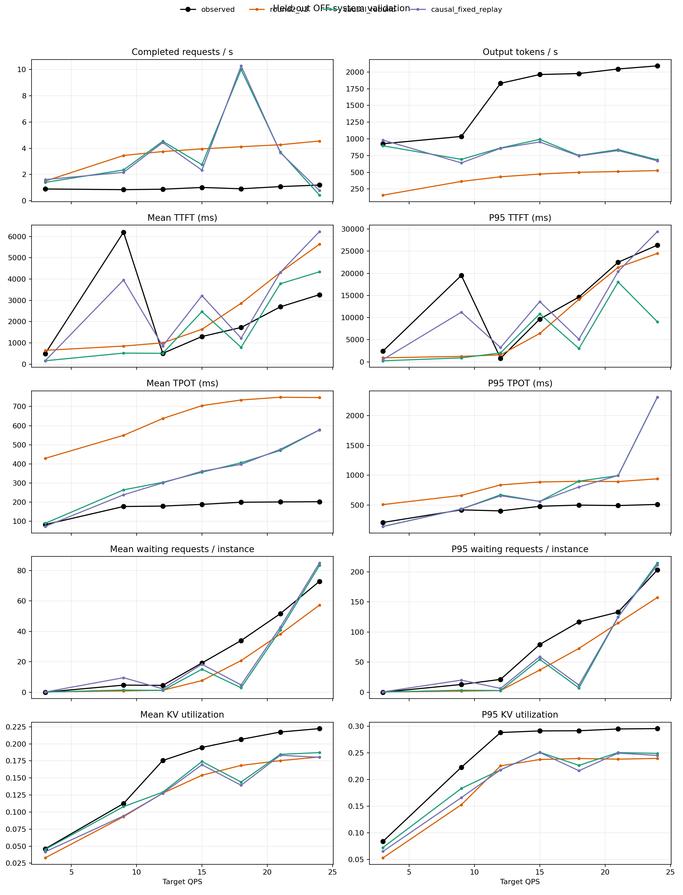
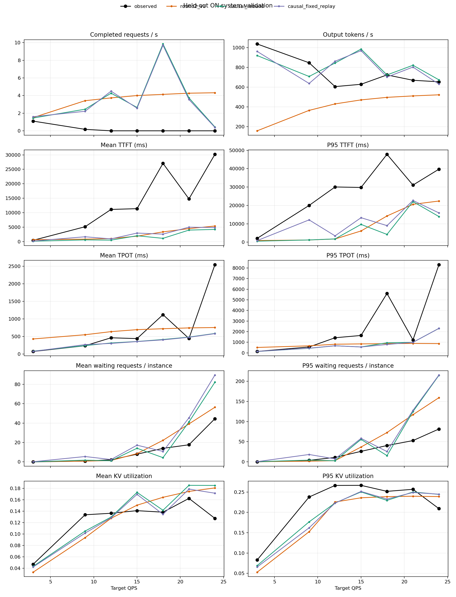
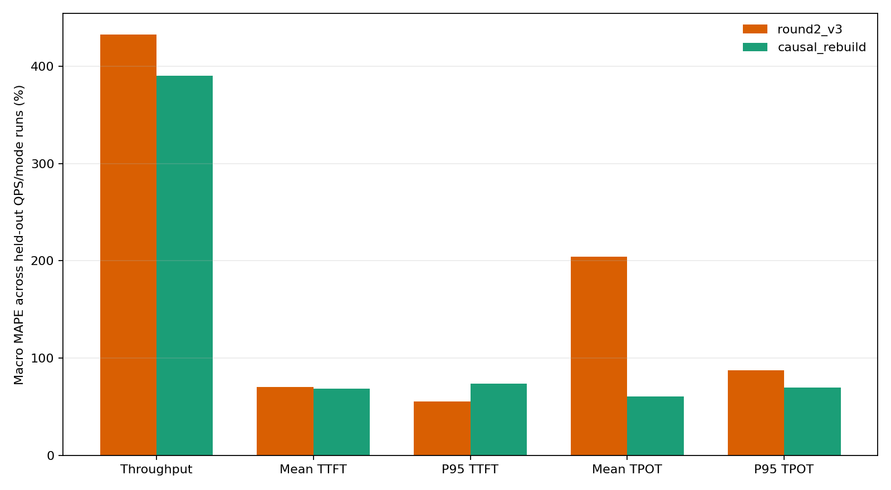

# Causal system validation

Training seed: 606; held-out seed: 808. 
Measurement/drain: 60s / 30s. 
The predictive simulator receives held-out measurement arrivals, prompt lengths, and budgets only.

## Held-out error summary

| Version | Metric | Macro MAPE | Macro MAE | Signed bias |
|:---|:---|---:|---:|---:|
| round2_v3 | request_throughput_rps | 432.67% | 3.060 | 3.060 |
| round2_v3 | output_tokens_per_sec | 56.84% | 794.440 | -794.440 |
| round2_v3 | ttft_mean_ms | 70.15% | 6740.622 | -5837.861 |
| round2_v3 | ttft_p95_ms | 55.37% | 11476.574 | -11365.581 |
| round2_v3 | tpot_mean_ms | 204.06% | 493.203 | 180.584 |
| round2_v3 | tpot_p95_ms | 87.66% | 1214.647 | -771.096 |
| round2_v3 | queue_mean_requests | 2048.00% | 7.441 | -1.356 |
| round2_v3 | queue_p95_requests | 63.75% | 26.841 | -0.270 |
| round2_v3 | kv_mean_fraction | 20.86% | 0.029 | -0.015 |
| round2_v3 | kv_p95_fraction | 20.69% | 0.045 | -0.041 |
| causal_rebuild | request_throughput_rps | 390.40% | 3.101 | 2.992 |
| causal_rebuild | output_tokens_per_sec | 34.03% | 512.363 | -402.654 |
| causal_rebuild | ttft_mean_ms | 68.92% | 6988.831 | -6513.091 |
| causal_rebuild | ttft_p95_ms | 73.55% | 14545.763 | -14203.180 |
| causal_rebuild | tpot_mean_ms | 60.88% | 298.690 | -114.534 |
| causal_rebuild | tpot_p95_ms | 69.75% | 1141.599 | -702.679 |
| causal_rebuild | queue_mean_requests | 715.98% | 10.142 | 1.131 |
| causal_rebuild | queue_p95_requests | 71.91% | 32.288 | 3.141 |
| causal_rebuild | kv_mean_fraction | 15.94% | 0.026 | -0.009 |
| causal_rebuild | kv_p95_fraction | 15.39% | 0.037 | -0.032 |
| causal_rebuild | migration_total_mean_ms | 67.50% | 729.569 | -729.569 |
| causal_rebuild | migration_pause_stage_mean_ms | 78.71% | 421.593 | -421.593 |
| causal_rebuild | migration_recovery_mean_ms | 5433.58% | 12857.438 | 5600.465 |
| causal_fixed_replay | request_throughput_rps | 370.51% | 3.036 | 2.976 |
| causal_fixed_replay | output_tokens_per_sec | 35.27% | 526.252 | -413.900 |
| causal_fixed_replay | ttft_mean_ms | 73.61% | 6563.953 | -5586.041 |
| causal_fixed_replay | ttft_p95_ms | 68.77% | 11025.996 | -9674.085 |
| causal_fixed_replay | tpot_mean_ms | 60.50% | 300.502 | -118.777 |
| causal_fixed_replay | tpot_p95_ms | 67.88% | 1144.141 | -721.020 |
| causal_fixed_replay | queue_mean_requests | 937.92% | 10.618 | 4.279 |
| causal_fixed_replay | queue_p95_requests | 94.99% | 31.372 | 7.517 |
| causal_fixed_replay | kv_mean_fraction | 17.23% | 0.027 | -0.014 |
| causal_fixed_replay | kv_p95_fraction | 17.63% | 0.041 | -0.036 |
| causal_fixed_replay | migration_total_mean_ms | 7.95% | 56.550 | 48.772 |
| causal_fixed_replay | migration_pause_stage_mean_ms | 26.11% | 283.997 | -283.997 |
| causal_fixed_replay | migration_recovery_mean_ms | 124.85% | 11367.286 | 8838.272 |

## Warmup phase boundary

| Mode | QPS | HTTP 200 | HTTP 499 | Migrations started | In flight at measurement start |
|:---:|---:|---:|---:|---:|---:|
| off | 12 | 192 | 0 | 0 | 0 |
| off | 15 | 233 | 0 | 0 | 0 |
| off | 18 | 272 | 0 | 0 | 0 |
| off | 21 | 301 | 0 | 0 | 0 |
| off | 24 | 362 | 0 | 0 | 0 |
| off | 3 | 56 | 0 | 0 | 0 |
| off | 9 | 139 | 0 | 0 | 0 |
| on | 12 | 192 | 0 | 0 | 0 |
| on | 15 | 233 | 0 | 6 | 0 |
| on | 18 | 248 | 24 | 6 | 0 |
| on | 21 | 301 | 0 | 2 | 0 |
| on | 24 | 362 | 0 | 2 | 0 |
| on | 3 | 56 | 0 | 1 | 0 |
| on | 9 | 139 | 0 | 0 | 0 |

## Per-run values

| Mode | QPS | Version | Request throughput | Token throughput | Mean/P95 TTFT ms | Mean/P95 TPOT ms | Queue mean/P95 | KV mean/P95 | Migrations (attempt/success/fail/abort) | Total/pause/recovery ms |
|:---:|---:|:---|---:|---:|---:|---:|---:|---:|:---:|---:|
| off | 12 | observed | 0.883 | 1831.2 | 506.6/798.1 | 179.7/401.3 | 4.48/21.25 | 17.55%/28.80% | 0/0/0/0 | 0.0/0.0/0.0 |
| off | 12 | round2_v3 | 3.750 | 432.8 | 1000.5/1575.1 | 637.1/838.2 | 1.30/2.75 | 12.76%/22.54% | 0/0/0/0 | 0.0/0.0/0.0 |
| off | 12 | causal_rebuild | 4.533 | 864.0 | 509.2/2017.7 | 303.7/671.6 | 1.15/2.75 | 12.91%/21.80% | 0/0/0/0 | 0.0/0.0/0.0 |
| off | 12 | causal_fixed_replay | 4.433 | 859.8 | 851.1/3233.0 | 300.8/655.0 | 2.17/6.25 | 12.75%/21.79% | 0/0/0/0 | 0.0/0.0/0.0 |
| off | 15 | observed | 1.017 | 1962.9 | 1298.4/9658.4 | 188.6/478.6 | 19.19/79.25 | 19.47%/29.10% | 0/0/0/0 | 0.0/0.0/0.0 |
| off | 15 | round2_v3 | 3.950 | 473.5 | 1637.5/6412.0 | 704.6/886.8 | 7.61/36.75 | 15.39%/23.73% | 0/0/0/0 | 0.0/0.0/0.0 |
| off | 15 | causal_rebuild | 2.750 | 993.0 | 2467.4/10836.9 | 356.5/560.6 | 15.08/54.50 | 17.41%/25.10% | 0/0/0/0 | 0.0/0.0/0.0 |
| off | 15 | causal_fixed_replay | 2.333 | 953.6 | 3215.9/13610.1 | 361.7/560.6 | 18.34/59.00 | 16.93%/25.05% | 0/0/0/0 | 0.0/0.0/0.0 |
| off | 18 | observed | 0.917 | 1977.2 | 1721.9/14647.0 | 199.7/498.4 | 33.98/116.75 | 20.65%/29.13% | 0/0/0/0 | 0.0/0.0/0.0 |
| off | 18 | round2_v3 | 4.117 | 499.9 | 2859.5/14119.6 | 734.0/898.1 | 20.79/72.75 | 16.83%/23.92% | 0/0/0/0 | 0.0/0.0/0.0 |
| off | 18 | causal_rebuild | 9.983 | 751.7 | 791.3/2999.6 | 406.2/900.6 | 2.88/7.00 | 14.40%/22.63% | 0/0/0/0 | 0.0/0.0/0.0 |
| off | 18 | causal_fixed_replay | 10.267 | 744.6 | 1221.9/5112.5 | 397.5/803.6 | 4.78/11.75 | 13.93%/21.63% | 0/0/0/0 | 0.0/0.0/0.0 |
| off | 21 | observed | 1.083 | 2046.0 | 2693.1/22502.2 | 201.3/490.9 | 51.64/133.00 | 21.73%/29.46% | 0/0/0/0 | 0.0/0.0/0.0 |
| off | 21 | round2_v3 | 4.267 | 511.7 | 4313.7/21348.8 | 748.4/893.9 | 38.23/115.00 | 17.54%/23.80% | 0/0/0/0 | 0.0/0.0/0.0 |
| off | 21 | causal_rebuild | 3.717 | 840.0 | 3777.5/18027.7 | 470.4/994.3 | 40.87/124.75 | 18.45%/25.04% | 0/0/0/0 | 0.0/0.0/0.0 |
| off | 21 | causal_fixed_replay | 3.667 | 825.7 | 4311.6/20409.3 | 476.1/996.2 | 42.73/125.01 | 18.32%/24.93% | 0/0/0/0 | 0.0/0.0/0.0 |
| off | 24 | observed | 1.200 | 2092.3 | 3264.6/26366.9 | 202.5/510.0 | 72.93/203.00 | 22.23%/29.53% | 0/0/0/0 | 0.0/0.0/0.0 |
| off | 24 | round2_v3 | 4.550 | 525.8 | 5637.2/24496.1 | 746.4/939.8 | 57.28/157.25 | 18.07%/23.94% | 0/0/0/0 | 0.0/0.0/0.0 |
| off | 24 | causal_rebuild | 0.433 | 686.1 | 4338.8/9056.2 | 577.4/2310.4 | 83.45/214.75 | 18.71%/24.88% | 0/0/0/0 | 0.0/0.0/0.0 |
| off | 24 | causal_fixed_replay | 0.783 | 671.7 | 6229.5/29443.7 | 578.2/2310.4 | 85.04/211.25 | 18.02%/24.50% | 0/0/0/0 | 0.0/0.0/0.0 |
| off | 3 | observed | 0.900 | 927.1 | 492.2/2430.7 | 83.0/206.8 | 0.00/0.00 | 4.62%/8.37% | 0/0/0/0 | 0.0/0.0/0.0 |
| off | 3 | round2_v3 | 1.500 | 158.2 | 648.7/907.6 | 428.9/507.4 | 0.20/0.50 | 3.29%/5.28% | 0/0/0/0 | 0.0/0.0/0.0 |
| off | 3 | causal_rebuild | 1.400 | 896.2 | 159.7/226.3 | 89.6/139.2 | 0.06/0.25 | 4.52%/7.23% | 0/0/0/0 | 0.0/0.0/0.0 |
| off | 3 | causal_fixed_replay | 1.617 | 981.9 | 157.1/510.5 | 73.0/139.2 | 0.08/0.50 | 4.17%/6.49% | 0/0/0/0 | 0.0/0.0/0.0 |
| off | 9 | observed | 0.850 | 1036.3 | 6200.8/19530.8 | 177.4/418.6 | 4.64/12.77 | 11.25%/22.28% | 0/0/0/0 | 0.0/0.0/0.0 |
| off | 9 | round2_v3 | 3.450 | 363.4 | 849.8/1226.5 | 549.4/661.3 | 0.81/1.75 | 9.32%/15.25% | 0/0/0/0 | 0.0/0.0/0.0 |
| off | 9 | causal_rebuild | 2.350 | 693.6 | 519.2/895.1 | 264.4/432.6 | 1.42/3.25 | 10.79%/18.31% | 0/0/0/0 | 0.0/0.0/0.0 |
| off | 9 | causal_fixed_replay | 2.167 | 640.4 | 3952.6/11228.6 | 238.6/432.6 | 9.53/20.00 | 9.43%/16.58% | 0/0/0/0 | 0.0/0.0/0.0 |
| on | 12 | observed | 0.000 | 605.7 | 11125.3/30033.3 | 462.9/1427.2 | 2.12/11.00 | 13.62%/26.63% | 1/1/0/0 | 1056.1/228.2/161.6 |
| on | 12 | round2_v3 | 3.733 | 430.2 | 1033.0/1748.3 | 637.9/817.7 | 1.41/3.01 | 12.74%/22.55% | 0/0/0/0 | 0.0/0.0/0.0 |
| on | 12 | causal_rebuild | 4.267 | 844.8 | 503.2/1780.9 | 315.8/671.6 | 1.15/2.75 | 12.95%/22.31% | 89/89/0/0 | 208.3/60.8/12865.0 |
| on | 12 | causal_fixed_replay | 4.500 | 862.5 | 934.0/3445.8 | 302.5/670.7 | 2.40/7.25 | 12.81%/22.28% | 0/0/0/0 | 0.0/0.0/0.0 |
| on | 15 | observed | 0.000 | 629.1 | 11392.5/29766.6 | 439.8/1641.9 | 7.92/26.00 | 14.07%/26.65% | 1/1/0/0 | 1028.2/447.0/2838.9 |
| on | 15 | round2_v3 | 4.000 | 470.9 | 1873.0/6100.2 | 694.0/847.7 | 8.51/36.75 | 15.04%/23.59% | 0/0/0/0 | 0.0/0.0/0.0 |
| on | 15 | causal_rebuild | 2.650 | 985.8 | 2015.5/9671.6 | 357.7/560.6 | 14.03/55.75 | 17.28%/25.03% | 43/43/0/0 | 206.4/60.2/12746.5 |
| on | 15 | causal_fixed_replay | 2.567 | 970.2 | 2946.5/13318.7 | 354.5/554.8 | 17.18/58.25 | 16.93%/25.15% | 0/0/0/0 | 0.0/0.0/0.0 |
| on | 18 | observed | 0.000 | 724.1 | 27066.8/47793.8 | 1120.7/5597.7 | 13.92/40.50 | 13.81%/25.17% | 5/4/0/1 | 1129.0/542.2/35885.3 |
| on | 18 | round2_v3 | 4.133 | 496.8 | 3362.5/14251.9 | 721.0/870.6 | 22.21/72.75 | 16.42%/23.87% | 0/0/0/0 | 0.0/0.0/0.0 |
| on | 18 | causal_rebuild | 9.850 | 723.9 | 1125.4/4225.3 | 414.4/952.2 | 4.33/15.50 | 14.15%/22.95% | 89/89/0/0 | 228.5/66.7/14114.4 |
| on | 18 | causal_fixed_replay | 9.700 | 702.3 | 2581.7/9008.5 | 403.9/793.8 | 10.79/25.50 | 13.44%/23.27% | 3/1/0/2 | 1117.4/524.3/32097.0 |
| on | 21 | observed | 0.000 | 669.9 | 14775.3/31056.1 | 443.2/1223.4 | 17.61/52.75 | 16.22%/25.68% | 2/2/0/0 | 639.6/182.2/144.5 |
| on | 21 | round2_v3 | 4.267 | 511.3 | 4490.0/20591.5 | 743.7/892.4 | 39.13/117.00 | 17.44%/23.97% | 0/0/0/0 | 0.0/0.0/0.0 |
| on | 21 | causal_rebuild | 3.733 | 822.1 | 3980.7/22070.0 | 482.8/996.2 | 41.19/124.76 | 18.51%/25.01% | 29/28/1/0 | 229.5/67.0/14175.0 |
| on | 21 | causal_fixed_replay | 3.550 | 803.6 | 4982.5/22690.2 | 477.0/996.2 | 45.43/127.75 | 17.85%/24.89% | 0/0/0/0 | 0.0/0.0/0.0 |
| on | 24 | observed | 0.000 | 654.4 | 30195.7/39714.2 | 2543.5/8313.1 | 44.52/81.50 | 12.72%/20.92% | 14/9/0/5 | 1569.3/1314.5/8452.0 |
| on | 24 | round2_v3 | 4.317 | 522.5 | 5388.8/22384.0 | 754.9/874.7 | 56.33/159.25 | 18.06%/23.88% | 0/0/0/0 | 0.0/0.0/0.0 |
| on | 24 | causal_rebuild | 0.433 | 674.2 | 4209.6/13944.8 | 586.5/2310.4 | 82.16/214.75 | 18.50%/24.43% | 33/33/0/0 | 210.8/61.5/13022.0 |
| on | 24 | causal_fixed_replay | 0.383 | 630.6 | 4866.6/15923.8 | 581.1/2310.4 | 89.59/215.50 | 17.13%/24.48% | 1/1/0/0 | 1685.8/507.6/38760.3 |
| on | 3 | observed | 1.100 | 1037.8 | 449.0/2083.5 | 72.5/138.0 | 0.00/0.00 | 4.69%/8.28% | 0/0/0/0 | 0.0/0.0/0.0 |
| on | 3 | round2_v3 | 1.500 | 157.5 | 648.0/901.6 | 429.8/512.6 | 0.20/0.50 | 3.29%/5.28% | 0/0/0/0 | 0.0/0.0/0.0 |
| on | 3 | causal_rebuild | 1.450 | 920.3 | 150.1/561.3 | 83.1/131.3 | 0.08/0.50 | 4.31%/6.90% | 86/85/1/0 | 267.0/77.9/16492.0 |
| on | 3 | causal_fixed_replay | 1.600 | 962.2 | 194.7/872.2 | 75.5/139.2 | 0.11/0.50 | 4.21%/6.55% | 0/0/0/0 | 0.0/0.0/0.0 |
| on | 9 | observed | 0.167 | 847.2 | 5136.3/19991.9 | 236.8/555.9 | 0.83/3.76 | 13.35%/23.78% | 2/2/0/0 | 269.5/199.1/97.2 |
| on | 9 | round2_v3 | 3.417 | 364.7 | 846.1/1192.1 | 549.6/665.3 | 0.79/1.75 | 9.34%/15.23% | 0/0/0/0 | 0.0/0.0/0.0 |
| on | 9 | causal_rebuild | 2.450 | 708.3 | 587.5/1215.6 | 239.6/432.4 | 1.73/4.25 | 10.50%/17.66% | 89/89/0/0 | 230.9/67.4/14259.5 |
| on | 9 | causal_fixed_replay | 2.217 | 637.5 | 1668.2/12129.5 | 268.5/444.8 | 5.49/18.26 | 10.14%/16.20% | 1/1/0/0 | 311.0/171.9/92.0 |

## Fixed batch schedule replay

Observed held-out batches are fixed inputs for this local service model check.

| Mode | QPS | Batches | Round 2 MAE ms / MAPE | Causal MAE ms / MAPE |
|:---:|---:|---:|---:|---:|
| off | 12 | 2166 | 329.56 / 424.21% | 31.96 / 27.33% |
| off | 15 | 1948 | 341.28 / 401.92% | 30.69 / 27.99% |
| off | 18 | 1820 | 351.30 / 389.55% | 31.83 / 27.21% |
| off | 21 | 1782 | 357.03 / 381.95% | 36.72 / 28.27% |
| off | 24 | 1620 | 359.94 / 335.74% | 39.45 / 31.67% |
| off | 3 | 3912 | 281.87 / 596.63% | 25.26 / 40.46% |
| off | 9 | 2661 | 306.63 / 519.02% | 29.55 / 31.07% |
| on | 12 | 1540 | 308.52 / 271.07% | 57.55 / 29.50% |
| on | 15 | 1265 | 341.52 / 257.33% | 75.36 / 29.24% |
| on | 18 | 1016 | 322.93 / 207.75% | 111.21 / 37.86% |
| on | 21 | 1259 | 309.62 / 229.41% | 63.42 / 29.02% |
| on | 24 | 988 | 314.17 / 217.70% | 120.99 / 38.20% |
| on | 3 | 3786 | 280.95 / 520.95% | 25.51 / 40.75% |
| on | 9 | 2201 | 318.41 / 375.10% | 36.89 / 29.70% |

## Fixed route and migration replay

| Mode | QPS | Observed migration starts | Replayed starts | Rejected starts | First-batch route coverage |
|:---:|---:|---:|---:|---:|---:|
| off | 12 | 0 | 0 | 0 | 77.0% |
| off | 15 | 0 | 0 | 0 | 62.6% |
| off | 18 | 0 | 0 | 0 | 52.2% |
| off | 21 | 0 | 0 | 0 | 44.8% |
| off | 24 | 0 | 0 | 0 | 39.7% |
| off | 3 | 0 | 0 | 0 | 100.0% |
| off | 9 | 0 | 0 | 0 | 92.4% |
| on | 12 | 1 | 1 | 1 | 78.5% |
| on | 15 | 1 | 1 | 1 | 70.4% |
| on | 18 | 5 | 5 | 2 | 75.3% |
| on | 21 | 2 | 2 | 2 | 81.4% |
| on | 24 | 14 | 14 | 13 | 67.6% |
| on | 3 | 0 | 0 | 0 | 99.0% |
| on | 9 | 2 | 2 | 1 | 89.2% |

## Accuracy gate

Independent accuracy gate passed: **False**.

| Metric | Passed | Worst held-out run | Error | Limit |
|:---|:---:|:---|---:|---:|
| request_throughput_rps | False | on QPS 12 | inf | 0.200 |
| ttft_mean_ms | False | on QPS 18 | 0.958 | 0.250 |
| ttft_p95_ms | False | off QPS 12 | 1.528 | 0.300 |
| tpot_mean_ms | False | off QPS 24 | 1.851 | 0.200 |
| tpot_p95_ms | False | off QPS 24 | 3.531 | 0.250 |
| queue_mean_requests | False | on QPS 24 | 37.642 | 8.905 |
| queue_p95_requests | False | on QPS 24 | 133.250 | 16.300 |
| kv_mean_fraction | False | off QPS 18 | 6.252 | 5.000 |
| kv_p95_fraction | True | off QPS 12 | 6.999 | 10.000 |
| request_lifecycle_and_collection | True | n/a | n/a | None |

## Figures

## Definitions and limitations

Queue and KV are resampled at 50 ms per-instance grids. Request output and server completion use the API/server event chain; client E2E is retained as a separate metric. HTTP 499 tails are counted as censored.
Warmup requests are drained or aborted before the measurement phase. The simulator starts with an empty request/KV state at that boundary; it does not model GPU cache or thermal effects from warmup.
Migration ON is evaluated with the simulator's greedy controller, while the real run uses the unchanged Llumnix routine. This tests the simulator's migration mechanism and trigger approximation; it is not an exact policy replay.
The fixed replay diagnostic uses held-out first-batch instance routes and observed ON migration starts, durations, pause, and recovery labels. It is a mechanism diagnostic and is excluded from the independent prediction gate.
A gate passes only when every OFF and ON QPS run meets the per-run threshold and every measurement request is joined to a terminal event.
