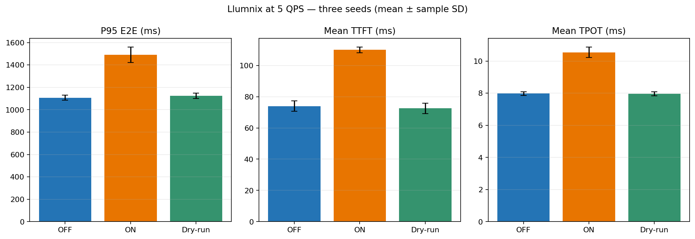

# QPS 5：Migration OFF / ON / Dry-run 三种模式对比

## 实验结果

每个数值为 3 个种子的均值 ± 样本标准差。TTFT/TPOT 使用服务端逐 Token 时延；样本数及 N/A 字段见 `summary.csv`。

| 模式 | P95 E2E (ms) | Mean TTFT (ms) | Mean TPOT (ms) | 完成请求吞吐 (req/s) | 成功/发送请求 | 成功迁移数 |
|---|---:|---:|---:|---:|---:|---:|
| OFF | 1107.71 ± 22.83 | 73.97 ± 3.38 | 7.97 ± 0.12 | 4.92 ± 0.48 | 98.3/98.3 | 0.0 |
| ON | 1491.29 ± 69.05 | 109.95 ± 1.80 | 10.54 ± 0.33 | 4.92 ± 0.48 | 98.3/98.3 | 17.3 |
| Dry-run | 1124.46 ± 24.53 | 72.53 ± 3.33 | 7.97 ± 0.13 | 4.92 ± 0.48 | 98.3/98.3 | 0.0 |

| 配对差值 | P95 E2E 相对 OFF 平均变化 | 跨种子标准差 | 配对种子数 |
|---|---:|---:|---:|
| ON vs OFF | N/A% | N/A% | 0 |
| Dry-run vs OFF | N/A% | N/A% | 0 |

## 实验设置与验证

- 状态：`complete`；QPS：5.0；种子：101, 202, 303。
- 四 GPU、4 个独立 Llumnix 实例、TP=1、Balanced 策略、`rayrpc` 后端、`remaining_steps` 负载指标；没有负载/网络/故障注入。
- OFF 设置 `ENABLE_ROUTINE_MIGRATION=false`。ON 设置为 `true` 并执行正常配对和迁移。Dry-run 同样设置为 `true`，保留迁移过滤与 Balanced 配对计算，但在调度迁移任务前丢弃配对。
- ON 与 Dry-run 的启动日志分别验证了开关；Ray 启动状态确认 4 张 GPU。迁移事件：ON 共记录 53 次（成功 52、失败 1）；Dry-run 迁移事件 0 次；dry-run 被丢弃候选配对合计 170 个。
- 每种模式使用同一 seed 的请求轨迹；运行器为每个 seed 只生成一条轨迹，并将同一轨迹对象依次交给 OFF、ON、Dry-run。各 seed 的轨迹 SHA-256：`{"101": "0ea4da0013ca32762c3104901d38c73052ba3c317a3ff0cb16f50f688286c307", "202": "4c175a8a1aeb16ac76bf4a528ab6c5fb62351a2bb7afe04b975c045aef80782f", "303": "c38d5b68f2f1050a125ce8ff30f441278a6322d9a1727b340b8615216b0d41f3"}`。
- 每组预热 5.0 秒、测量 20.0 秒，发送停止后最多排空 180.0 秒。完成率和 SLO 指标见 CSV。
- 样本量只有 3 个种子，且测量窗口为快速实验设置；结果用于模式对比，不代表正式显著性检验。

## 图表



## 文件

- `requests.csv`：逐请求数据。
- `gpu_metrics.csv`：逐 GPU 资源采样。
- `migration_events.csv`、`pairing_ablation_events.csv`：迁移完成事件和 dry-run 丢弃配对日志。
- `summary.csv`：每种模式每个种子的指标及均值、样本标准差。
- `config.json`、`state.json`、`environment_audit.md`、`configs/`、`traces/`、`server_logs/`：配置、状态、环境、轨迹与启动日志。

## 复现

```bash
cd /workspace/Large-Language-Model-Inference-Scheduling-under-Multiple-Disturbances-upstream
.venv/bin/python benchmark/run_qps5_three_mode.py --seeds 101 202 303 --qps 5.0 --warmup-sec 5.0 --measure-sec 20.0 --drain-sec 180.0 --policy balanced
```
