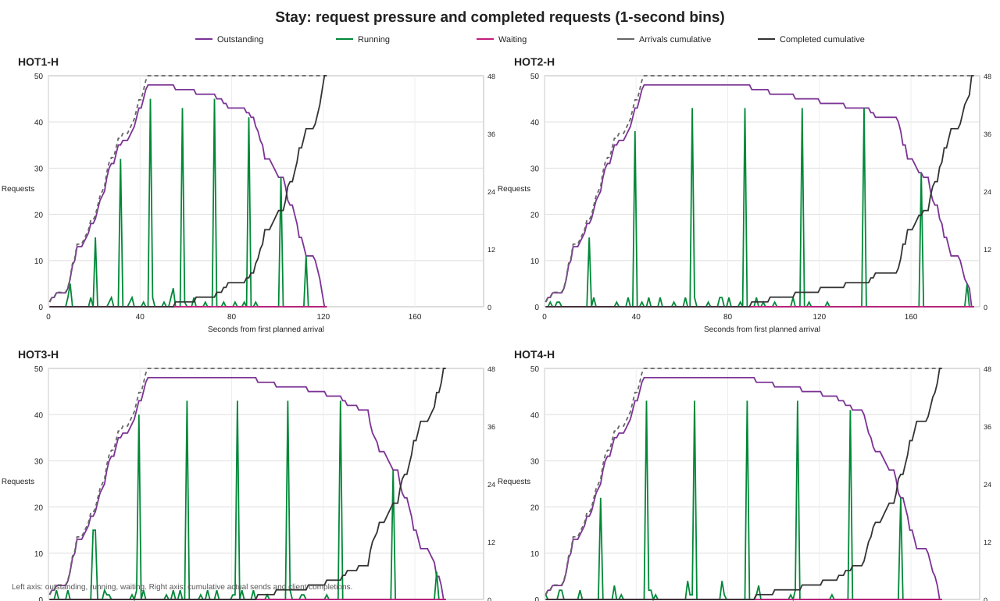
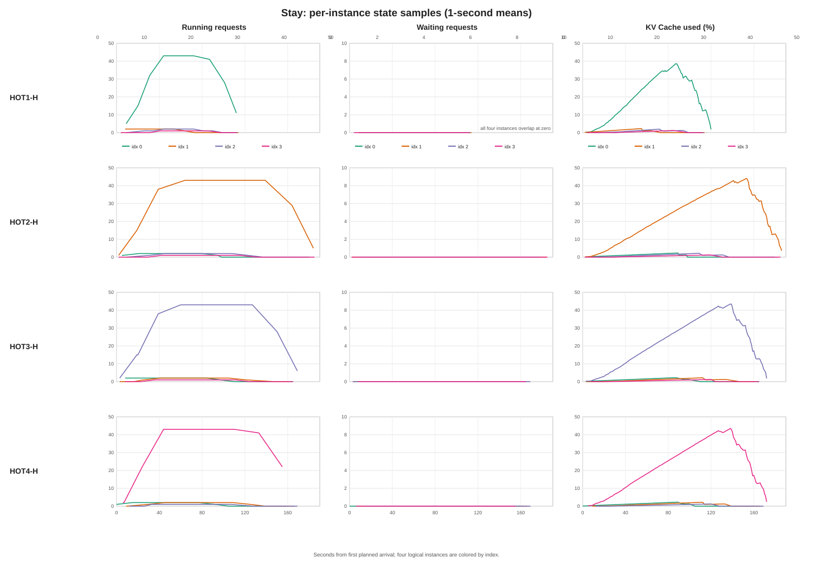

# HOT1-H Stay 异常低成本专项审计

**审计范围：** 只读复核既有 HOT1/2/3/4-H 记录、HOT1-H 复测、运行配置和请求执行链路。没有重跑 GPU 实验，没有改写原始日志、trace 或筛选结论；没有进行 PPO 训练或物理模型拟合。

## 结论先行

现有数据可以把差异定位到**热点引擎的 Decode 执行速度**：四个 H 场景的热点实例都接纳了同一组 43 个请求，每个请求实测输入 128 token、输出 1536 token；但 HOT1-H 热点请求 Mean TPOT 为 52.64 ms，HOT2/3/4-H 为 85.45–94.89 ms。稀疏记录到的 43 请求 Decode batch GPU 执行时间也分别为 43.10 ms 与 66.65–81.43 ms。这与 HOT1-H 的 Mean E2E、CVaR95 同时下降相符。

因此，**HOT1-H 稳定较快不是请求少了、输出截短、少算尾部或 Stay 中发生迁移造成的**。当前证据还不能说明 GPU 执行时间为何较短。最重要的混杂因素是：HOT1-H 配对及复测发生在 2026-11-06 的独立服务会话，HOT2/3/4-H 与 HOT1-L/M 来自 2026-11-05 的另一服务会话；模型、软件版本、声明配置和 GPU 清单相同，但没有运行期间的 GPU 时钟、功耗、温度或并行任务遥测。故本报告确认“快在何处”，不把它伪装成已确认的底层根因。

## 复测结果

QPS=1 的 HOT1-H Stay 记录如下。三次工作负载种子不同，适合判断稳定范围，不是逐请求完全相同的重复样本。

| 记录 | QPS | arrival / prompt seed | Stay C (s) | Balanced C (s) | HOT1 物理 GPU |
|---|---:|---|---:|---:|---:|
| 匹配 H234 的配对 | 1.00 | 26110523 / 26110521 | 160.901 | 225.393 | GPU 1 |
| 第一次复测 | 1.00 | 26110671 / 26110672 | 158.940 | 218.411 | GPU 0 |
| 第二次复测 | 1.00 | 26110681 / 26110682 | 170.833 | 223.476 | GPU 3 |
| 按条件升到 1.25 QPS | 1.25 | 26110691 / 26110692 | 182.787 | 239.593 | GPU 3 |

QPS=1 的三次 C 均值为 163.558 s，标准差 5.206 s，范围 158.940–170.833 s。1.25 QPS 这一轮 Balanced 仍比 Stay 高 31.08%，没有正收益。该 1.25 QPS 结果没有对应的 HOT2/3/4-H 1.25 QPS 对照，不能拿它与 QPS=1 的 H234 直接做严格场景差值。

复测的四个热点位置均为逻辑 index 0，但 HOT1 热点对应的物理 GPU 在 GPU 0、1、3 间变化，C 仍落在上述低成本范围。这削弱了“某一张固定物理卡始终更快”作为唯一解释；它不能排除运行会话、GPU 动态状态或逻辑实例关联效应。

## P0：实验可比性

### H 组 trace 和实际请求

HOT1-H 与 HOT2/3/4-H 的匹配配对数据如下：

| 场景 | QPS / N | arrival / prompt seed | base_trace_hash | full_trace_hash 前缀 | 热点 index（0-based） | 实际路由计数（index 0/1/2/3） | 热点物理 GPU |
|---|---:|---|---|---|---:|---|---:|
| HOT1-H | 1.00 / 48 | 26110523 / 26110521 | `e9398d9d0637…fc59d6d3` | `75713ddc04af` | 0 | 43 / 2 / 2 / 1 | 1 |
| HOT2-H | 1.00 / 48 | 26110523 / 26110521 | 同上 | `a6ce57c19af8` | 1 | 2 / 43 / 2 / 1 | 3 |
| HOT3-H | 1.00 / 48 | 26110523 / 26110521 | 同上 | `91f271cbc405` | 2 | 2 / 2 / 43 / 1 | 2 |
| HOT4-H | 1.00 / 48 | 26110523 / 26110521 | 同上 | `99d6195dd0e0` | 3 | 2 / 2 / 1 / 43 | 0 |

四个 `trace.json` 在去掉 `initial_instance_index`、`hot_instance_index`、`routing_mode` 和 `candidate_id` 后逐行完全相同；request ID 均为 `trace_48_1_26110521_00000` 至 `...00047`，计划到达时间和 prompt 内容也相同。四场景热点上的 **43 个 request ID 完全相同**。full trace hash 不同是路由和候选元数据不同造成的。

每场景 48/48 请求成功完成，48 个实际输入长度均为 128 token，48 个最终输出长度均为 1536 token；总输出均为 73,728 token。没有取消、缺失、重复或提前结束请求。真实发送相对计划时间的平均延迟为 1.89–2.18 ms，P95 为 4.48–4.59 ms，最大为 7.26–12.76 ms；未观察到发送端把某一场景的到达显著推迟。采样窗口为 48 秒的均匀固定数量到达。

### 实例、物理 GPU 和服务配置

匹配配对中的逻辑实例到 Ray GPU 映射相同：逻辑 index 0/1/2/3 分别映射到 GPU 1/3/2/0。HOT1-H 使用自己的服务会话和一组新的 instance ID；HOT2/3/4-H 共用另一服务会话。GPU 清单相同，四张卡均为 RTX 3060 12 GiB：GPU 0 `GPU-f3cc…a4124`（PCI 01:00.0）、GPU 1 `GPU-8ec0…91ddd`（04:00.0）、GPU 2 `GPU-55fb…5d9f47d`（83:00.0）、GPU 3 `GPU-de41…b5b0ee`（84:00.0）。环境快照中的每实例 KV 总块数都是 8,565。

两次环境快照的归一化 runtime YAML、`real_llumnix.yaml`、模型文件 SHA256 和 GPU inventory 相同。实际运行版本也相同：vLLM 0.6.3.post1、PyTorch 2.4.0、Ray 2.47.1、tokenizers 0.20.3。模型为 Qwen2-1.5B，`config.json`、`tokenizer.json`、`model.safetensors` 的哈希一致。主要服务参数为 TP=1、FP16、`enforce_eager=True`、`max_model_len=2112`、`max_num_seqs=128`、`max_num_batched_tokens=2112`、`gpu_memory_utilization=0.65`、四实例、`rayqueue`、`rayrpc`。采样参数为 temperature=0、top_k=1、ignore_eos=True，且请求 `min_tokens=max_tokens=1536`。

以下差异意味着四个场景**不是严格意义上只改变了热点物理位置**：

1. HOT1-H 的匹配运行在 11 月 6 日 followup 服务会话；HOT2/3/4-H 在 11 月 5 日 multienv 服务会话。软件和静态配置相同，但会话及运行时段不同。
2. 路由生成器将其余 5 个请求按轮转分配到三个非热点实例，计数为 2/2/1；当热点 index 变化时，非热点 route 字段随之轮换。热点上的 43 个请求 ID 则完全相同。
3. 服务配置快照没有记录每秒 GPU 时钟、功耗、温度、P-state、持续 GPU 利用率或运行中的其他任务，因此这些运行时变量无法匹配。

### 实际路由、执行和 Stay 行为

HOT1-H 使用 0-based `initial_instance_index=0`，即第一逻辑实例（通常口语称 instance 1）。四组 episode 的 `real_initial_route` 和 `request_engine_admitted` 各有 48 条；每条事件均可由 episode event stream 对回外部 request ID，Manager 首次路由与 engine 首次接纳的实例 ID 对 48/48 一致，没有 fallback 或实际执行错位。HOT1-H 43 个热点请求均路由、接纳到 instance ID `58ae50d2…` / GPU 1；H2/H3/H4 的 43 个请求也分别接纳到配置的热点 instance ID。

四个 Stay episode 的迁移启动、成功、失败和协调器迁移记录均为 0；所有决策均为 Stay 类，scaling 关闭。routine/pre-stop migration 虽出现在服务配置中，但这四个 Stay episode 没有实际迁移或重调度行为。

### 主成本 C 的统计边界

`C = Mean(client_e2e_ms) + CVaR95(client_e2e_ms)`，单位毫秒。E2E 从请求实际 `sent_ns` 计到客户端 terminal；统计集合为该 episode 的 48 个完整请求。CVaR95 使用精确的分数尾部权重，48 个样本对应 2.4 个尾部样本的有效质量；成本实现见 [`cvar95`](../full_completion.py#L37) 及 [`summarize_full_cohort` 的请求时间字段](../full_completion.py#L450)。因此不是以请求计划时刻起算，也没有从 C 中剔除尾部请求。

## P1：HOT1-H 快在哪里

### 完整请求分布和吞吐

| 场景 | Mean E2E (s) | P50 (s) | P95 (s) | P99 (s) | CVaR95 (s) | Max (s) | C (s) | Mean TTFT (ms) | Mean TPOT (ms) | 输出 token/s¹ | 首发到末完成 (s) |
|---|---:|---:|---:|---:|---:|---:|---:|---:|---:|---:|---:|
| HOT1-H | 78.221 | 81.504 | 82.671 | 82.682 | 82.680 | 82.682 | 160.901 | 101.98 | 50.89 | 612.45 | 120.38 |
| HOT2-H | 140.142 | 145.845 | 147.425 | 147.514 | 147.500 | 147.521 | 287.642 | 273.42 | 91.12 | 396.04 | 186.16 |
| HOT3-H | 127.274 | 131.200 | 132.639 | 132.707 | 132.695 | 132.732 | 259.969 | 156.97 | 82.81 | 428.08 | 172.23 |
| HOT4-H | 127.376 | 131.305 | 132.660 | 132.699 | 132.693 | 132.716 | 260.068 | 138.71 | 82.89 | 427.51 | 172.46 |

¹ 总输出 token 数除以“首个实际发送到最后一个客户端完成”的时间跨度。四场景分子均为 73,728 token。

Mean E2E 和 CVaR95 都大幅下降，P50、P95、P99、最大值也整体同步下降；异常不是只改善了几个尾部请求。HOT1-H 的热点组（43 个请求）Mean E2E=80.91 s、Mean TPOT=52.64 ms；H2/H3/H4 热点组分别为 145.94/131.32/131.43 s 和 94.89/85.45/85.53 ms。相同 43 个请求产生相同数量的输出，热点组输出速率分别约 554.71 token/s 与 357.37/386.49/385.93 token/s。

对照 HOT1 的 L/M 记录：HOT1-L 实际 24 个请求路由到 index 0，热点 Mean TPOT=74.57 ms、C=224.097 s；HOT1-M 实际 34 个热点请求，Mean TPOT=77.72 ms、C=235.265 s。H 场景热点组为 43 个请求，Mean TPOT=52.64 ms。L/M 的会话和到达配置并不完全匹配（M 为 0.6 QPS），因此该比较支持“高负载区行为不同”，不能单独证明批量大小是根因。

### 每秒到达、完成、Running、Waiting 和 KV

图中按秒绘制实际累计发送、累计完成和 outstanding；同时叠加四实例 Running/Waiting 总量。第二图按逻辑实例绘出 Running、Waiting、KV 使用率的一秒事件样本均值。





每个场景 outstanding 峰值均为 48。热点实例 Running 峰值均为 43；热点 Waiting 峰值为 0。热点 KV 的 P95/峰值分别为：HOT1-H 37.05%/38.86%，HOT2-H 42.55%/44.17%，HOT3-H 41.91%/43.81%，HOT4-H 41.95%/43.75%。热点 KV 在 HOT1-H 略低，但仍有超过 60% 的快照块余量；没有证据表明 H234 因 KV 满载、等待队列或抢占而比 HOT1 慢一倍。稀疏采样到的热点 Decode batch 中，preempted、swap-out 均为 0。

图表依据 episode `events.jsonl.gz` 的嵌套诊断事件按秒分箱；它不是连续 GPU 遥测。scheduler_idle 事件注明 50 ms 周期，服务会话另记录高频诊断抽样间隔 256，因此图线是有事件时的分箱均值，不应当读成等间隔硬件采样。

### 尾部请求时间线

以下是每场景最大 E2E 请求。`admit` 和 `首 token` 为相对实际发送的毫秒数；`结束` 为相对首个计划到达的秒数。所有列出的请求均实际输出 1536 token，并经 Manager 与 engine 路由审计确认。

| 场景 / request ID | route index | HTTP accepted (ms) | engine admission (ms) | engine 首 token (ms) | client TTFT (ms) | TPOT (ms) | E2E (s) | 结束时刻 (s) |
|---|---:|---:|---:|---:|---:|---:|---:|---:|
| HOT1-H `...00021` | 0 | 17.08 | 19.58 | 80.18 | 92.68 | 53.80 | 82.682 | 104.266 |
| HOT2-H `...00024` | 1 | 15.26 | 20.79 | 135.38 | 154.78 | 96.00 | 147.521 | 171.518 |
| HOT3-H `...00024` | 2 | 45.04 | 52.01 | 158.61 | 171.29 | 86.36 | 132.732 | 156.731 |
| HOT4-H `...00018` | 3 | 20.76 | 29.32 | 161.34 | 175.20 | 86.35 | 132.716 | 152.870 |

HOT1-H 最慢请求也完成得比 H2/H3/H4 最慢请求早约 50–67 秒；其 admission 和首 token 并未被统计遗漏。完整每场景 Top-5 尾部记录、请求时间戳和 GPU 映射见 [`tail_request_details.csv`](../../benchmark/results/hot1h_stay_anomaly_audit_assets/tail_request_details.csv)。

CVaR95 的有效尾部质量是 2.4 个请求；各场景 Top-5 都非常紧密，不能把差距解释成单个离群请求：

| 场景 | Top-5 request ID 后缀 | Top-5 E2E 范围 (s) |
|---|---|---:|
| HOT1-H | 21, 25, 23, 24, 27 | 82.670–82.682 |
| HOT2-H | 24, 25, 26, 21, 28 | 147.395–147.521 |
| HOT3-H | 24, 25, 26, 19, 27 | 132.613–132.732 |
| HOT4-H | 18, 21, 19, 23, 20 | 132.640–132.716 |

## P2：请求链路与索引代码审查

沿真实执行链路审查后的结论：

1. [`_trace_with_routing`](../../benchmark/mig_ppo_v2_multienv.py#L130) 用同一 arrival seed 洗牌并取 `round(48×0.9)=43` 个热点请求；剩余 5 个轮流分给其他三个 index。代码对 index 0 没有特殊分支。
2. [`FullCompletionIO.prepare`](../full_completion.py#L289) 按 `gpu_index is not None` 判断是否固定路由，再用 `self.mapping[gpu_index][0]` 映射到 instance ID。index 0 不会被误判成 false，也没有 0/1-based 偏移。
3. [`generate_real_metrics`](../../llumnix/entrypoints/vllm/real_metrics_stream.py#L28) 将显式 `initial_instance_id` 传给 Manager，并生成可连接到 trace request ID 的 server ID。
4. [`Manager.generate`](../../llumnix/manager.py#L178) 对显式 ID 做实例存在性和 lease 校验，记录 `real_initial_route`，并直接选定该实例；无效路由会失败，不会静默 fallback 到 dispatch。
5. [`LLMEngine.add_request`](../../llumnix/backends/vllm/llm_engine.py#L373) 记录 `request_engine_admitted`。episode route audit 将实际 manager 路由和 engine 首次接纳逐 request 比较；48/48 匹配。
6. 请求指标从实际 sent、first token、最后 token 和 terminal 事件汇总；server terminal 又审计了输入/输出 token 长度。C 使用该完整请求集合。

因此，0-based/1-based、index 0 falsey、请求路由 fallback、请求漏记、输出截短、首执行实例错位和 Stay 迁移均未解释 HOT1-H 异常。显式固定路由也绕过 native `load/remaining_steps/top-k` 分发选择逻辑。

## P3：H 强度非线性与可能原因

### 直接测得的 Decode 执行差异

episode event stream 中记录了 `gpu_execution_completed` 和 `engine_iteration_completed`。只比较热点实例、且采样时恰为 43 个 Decode 请求的 batch：

| 场景 | GPU elapsed 样本数 / 均值 (ms) | executor wall 样本数 / 均值 (ms) | GPU 样本范围 (ms) |
|---|---:|---:|---:|
| HOT1-H | 3 / 43.10 | 3 / 47.36 | 38.21–52.13 |
| HOT2-H | 4 / 68.48 | 4 / 71.47 | 63.06–72.87 |
| HOT3-H | 4 / 66.65 | 4 / 68.77 | 63.04–71.23 |
| HOT4-H | 4 / 81.43 | 4 / 85.60 | 70.11–109.04 |

GPU elapsed 使用 `torch_cuda_events_async_no_synchronize` 计时方法。样本很稀疏（每场景 3–4 个 43-request batch），不足以把整个 episode 的性能差精确归因到 GPU 时钟；但它独立支持客户端 TPOT 所显示的差别不是 C 汇总公式制造出来的。

HOT1-H 三次 QPS=1 运行在 GPU 1、0、3 上，43-request batch 的 GPU elapsed 样本均值分别为 43.10、39.61、45.88 ms。QPS=1.25 这一轮映射 GPU 3，样本均值 40.99 ms。HOT1-H 持续快与某一张固定卡的物理编号不绑定。HOT1-L/M 的 index 0 热点批量峰值为 24/34，TPOT 为 74.57/77.72 ms，采样 GPU elapsed 大多在约 64–74 ms；这说明 H 区间批量/运行状态有所不同，但 H2/3/4-H 同样达到 43 个热点运行请求且 GPU 时间仍较长，故“43 并发本身”不能解释 HOT1-H 与其他 H 的差异。

### 原因排序

| 判断 | 证据和范围 |
|---|---|
| **已确认：异常出现在热点引擎 Decode 服务速度** | 请求工作量、热点 request ID 集合、成功数、输出 token 数相同；HOT1-H 热点 TPOT 更低，按 43 Decode 请求采样的 GPU elapsed 也更低。 |
| **有证据支持但未确认：HOT1-H 会话/运行时状态较快** | HOT1-H 配对与复测在 11 月 6 日独立服务会话，H234 与 HOT1-L/M 在 11 月 5 日会话。多个 HOT1-H 新会话重复了低 C，且热点映射到多张物理 GPU；运行期 GPU/CPU 资源状态没有记录。 |
| **有证据支持但未确认：高强度批量响应与 instance/session 有交互** | HOT1-H 43 并发下的采样 GPU 时间低于其 L/M 24/34 并发样本；H234-H 的 43 并发样本却较慢。单纯并发大小不足以解释，需交叉控制服务会话、GPU 和逻辑 index。 |
| **已排除：请求少、token 少、尾部漏算、Stay 搬迁** | 四组均 48/48、128/1536 token、全部成功；E2E P95/CVaR/max 一致向下；Stay 迁移数为 0。 |
| **已排除为唯一原因：某一固定 GPU 型号/编号更快** | GPU 型号相同，HOT1-H 复测跨 GPU 0/1/3 均快；仍不能排除不同会话下同一 GPU 的动态时钟、功耗、温度或邻近任务。 |
| **已排除：逻辑 index 0 的明显路由代码错误** | 显式 index 0 被正确映射，Manager 首路由、engine 首接纳、实际执行实例逐请求一致；源代码没有 index 0 专属执行分支。 |
| **证据不足：最终硬件/软件根因** | 没有 episode 期间的 GPU 时钟/功耗/温度/利用率时间序列、每实例 CPU 调度数据和受控同会话热点交叉测试。静态配置快照无法替代这些证据。 |

## P4：Balanced 的有限核对

只有在上文把 Stay 差异定位到热点 Decode 执行速度后，才核对了匹配 HOT1-H Balanced 记录。它的 C=225.393 s；`execution_audit` 中有 26 次成功迁移、2 条因 `SR_candidate_changed_at_execution` 被拒绝的终态记录。26 次成功迁移均从逻辑 index 0 出发，目标为 index 1/2/3 的数量分别为 9/8/9；迁移覆盖 26 个不同请求，没有同一请求重复迁移或反向迁移。

这说明 Balanced 确实把热点请求分散到了其他实例，但本审计没有把 Balanced 与 Stay 的差额平均分配给迁移，也没有把它当作 Stay 异常的原因。Balanced 的迁移目标和 episode 数据位于 matched comparison 的 `Balanced` 目录、`execution_audit.json` 和 `events.jsonl.gz`。

## 最小下一步验证建议

不建议据本审计直接修改公共路由行为。若需要区分会话/GPU 动态状态与逻辑 index/批量行为，最小的补充设计是：

1. 在同一服务会话内用相同 base trace、48 请求和 1536 输出，按交错顺序跑 HOT1-H/HOT2-H/HOT3-H/HOT4-H；再反转顺序跑一轮，减少冷启动、热状态和顺序影响。
2. 每秒记录 GPU UUID、GPU/显存利用率、graphics/memory clock、温度、功耗和 P-state；同时保留每实例 PID、Running/Waiting、`gpu_execution_completed` 与 `engine_iteration_completed` 样本。
3. 若同会话仍表现为 index 0 快，再交叉轮换逻辑实例与物理 GPU 绑定；这样才可区分 index/actor 关联与物理设备状态。
4. 需要比较 HOT1-L/M 时，使用同一 prompt/arrival trace 与同一服务会话，只改变热点比例；否则 QPS 或会话变化会继续混杂。

这只是建议，没有启动上述实验。

## 原始记录与复现

匹配 H 数据：

- HOT1-H：`benchmark/results/mig_ppo_v2_followup_20261106T080500Z/comparisons/HOT1-H_backup_n48_q1p0_s26110523_followup.json`
- HOT2/3/4-H：`benchmark/results/mig_ppo_v2_multienv_20261105T130307Z/comparisons/HOT{2,3,4}-H_backup_n48_q1p0_s26110523.json`
- 每个 Stay episode 的原始请求/事件/trace/决策/审计：相应 run 根目录下 `runs/<episode_id>/{trace.json,requests.jsonl.gz,events.jsonl.gz,decisions.jsonl.gz,episode.json,execution_audit.json,opportunity.json}`
- 静态配置和运行环境：各 run 根目录下 `runtime_config.yaml`、`real_llumnix.yaml`、`environment_audit.json`、`service_session.json`、`api_server.log`
- HOT1-H 复测：`benchmark/results/mig_ppo_v2_hot1h_repeat_20261106T083209Z/`、`benchmark/results/mig_ppo_v2_hot1h_repeat2_20261106T084608Z/`、`benchmark/results/mig_ppo_v2_hot1h_q1p25_20261106T085546Z/`
- HOT1-L/M：`benchmark/results/mig_ppo_v2_multienv_20261105T130307Z/comparisons/HOT1-{L,M}_*.json`

只读重建数值表和 SVG 曲线（不会发请求或启动 GPU 服务）：

```bash
python benchmark/audit_hot1h_stay_anomaly.py
```

脚本输出到 `benchmark/results/hot1h_stay_anomaly_audit_assets/`；内含逐秒曲线 CSV、Top-5 尾部时间线 CSV 和供报告使用的审计 JSON。入口脚本本身不改原始结果。
