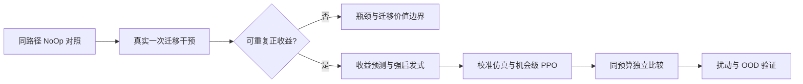

# 多元扰动下基于 Llumnix 的强化学习迁移调度：研究与实施规划 v2

日期：2026-11-04（Asia/Shanghai）  
交付性质：研究设计、工程任务书与实验协议，并记录已作出的环境选择。除明确写明的实验结果外，本文其余建议不表示已实现或验证。

## 本轮执行决策：固定 Q15-B 作为后续 PPO 环境

根据用户最新决定，**同一 trace 上完成 Stay 与 Balanced 配对并通过，即接受该环境供后续 PPO 使用；不再要求额外的候选对比或多 seed 确认**。选定环境为 Qwen2-1.5B 的 Q15-B：128 输入 token、1536 输出 token、每轮 128 个请求、0.6 req/s、初始 90% 热点。具体服务参数和证据见 §5.1。

本次同 trace 重放使用 seed 141104，Balanced 与 Stay 均完成 128/128 请求且审计通过。Balanced 相对 Stay 的 cost 降低 16.94%、平均 E2E 降低 19.52%、P95 降低 14.67%；成功迁移 43 次，覆盖 43 个不同请求（33.59%）。依据用户决定，本计划将 Q15-B 记为**已接受的 PPO 开发/训练环境**。这是一项明确的工程选择，证据是单 seed 配对；不据此声称多 seed 稳健性、普遍因果结论或 PPO 已有收益。

本轮不把 Qwen2-0.5B 的 S1_06/S1_04 当作 1.5B 证据，也不再比较 Q15-A 与其他候选。Balanced 阈值按预热后实际 KV 容量的 `min(total_blocks_i)/8` 冻结，本次值为 1070.625；Q15-B 的历史 P0 路径检查来自 Q15-A/1.0 req/s，属于有限复用，后续 PPO 首轮须继续记录控制开销和发包延迟。原始 replay 文件仍保留自动 `recommended=false`（它执行的是旧的双 seed 自动门槛）；本计划中的“接受环境”是用户作出的后续工作决定，不改写原始实验判定。实验细节见 [配对重放报告](../../benchmark/results/p0p1_fast_replay_20261104T124801Z/report.md)、[比较结果](../../benchmark/results/p0p1_fast_replay_20261104T124801Z/comparison.json) 和 [原快速筛选任务书](p0p1_fast_track_prompt.md)。

需要修正的训练认识：PPO 根据优势信号更新动作概率，不按动作出现频率自动强化。仅 Stay 合法时，正确掩码使 Stay 概率为 1，该样本的 actor 直接策略梯度为 0；但它仍占采样/计算资源，并可能通过优势归一化、critic 和共享表示影响训练。因此应分别统计“只能 Stay”“有选择但 Stay”“选择迁移”，不能靠给迁移奖金或强行删掉自愿 Stay 来制造学习。

每轮有较多成功迁移是筛选条件之一，不能代替正收益；同一请求反复搬运也不能充当充足样本。5 s 冷却下，所有时间步中的迁移动作占比只有约 10%–20% 并不异常。本轮同时看：合法机会数量/占比、条件于机会的迁移比例、成功次数、不同请求覆盖、每分钟成功次数和真实服务改善。后续训练可另行合并只能 Stay 的时间段，但须完整保留时间成本与迟延回报；本轮不改 PPO 更新。

## 已交付首轮：P2 与 P3 合并执行

该轮按用户要求同时推进 PPO 学习链路检查与最小仿真校准，使用 [P2/P3 联合执行 Prompt](p2p3_q15b_execution_prompt.md)。任务书保持已接受的 Qwen2-1.5B / Q15-B 环境，先复用已有日志完成 CPU 检查与校准，预算为真实运行最多两个完整 PPO cohort、一次 PPO 更新，不重新筛选环境。

这轮在显式版本化的新配置中实现 `choice_only` 策略更新：完整保留所有时间步的成本和回报，只在存在合法迁移动作的状态上计算 actor 归一化与损失，保留主动选择 Stay 的样本；critic 继续使用全部时间步。P2 的链路正确性与 P3 的闭环校准分别验收。它是两阶段的最小首轮交付，不表示复杂收益预测器、强基线或大规模训练已经完成；后续研究范围仍以下文为准。

## 下一步交付：先迁移到 Windows / WSL2，再进行 P4 短训

[P2/P3 交付报告](../../benchmark/results/p2p3_q15b_20261104T135200Z/report.md)记录了一个完整真实 cohort 和一次 PPO 更新；只读 verify 已复核通过。真实成功迁移 39 次、涉及 20 个请求，包含 19 次重复和 6 次反向迁移，尚无更新后性能证据。仿真通过范围仅为 Q15-B 的 Stay/Balanced 开发校准，Q15-A 负收益方向未复现。

按用户降低租赁成本的要求，下一轮使用 [本机迁移与 P4 任务书](p4_local_cpu_migration_prompt.md)：服务器不新增采样，只导出便携 CPU 训练包和研究归档；在 Windows / WSL2 完成独立安装、PPO 行为仿真验证和有限预算训练。获得候选后，再安排同一新 trace 上的 PPO/Stay 真实配对。此顺序替代上一轮 next_step 中继续真实采样的建议；不得把包已导出、仿真训练完成或单次真实配对分别夸大为迁移完成、真实有效或普遍优越。

## 1. 研究主张与当前起点

建议把核心问题定义为：**在存在测量延迟、剩余生成长度不确定和资源扰动时，如何判断一次在线 KV 迁移能否在请求结束或热点消失之前收回成本，并用有限真实样本学习稳定的迁移决策？**

“把 Llumnix 的阈值换成 PPO”“加入预测/GNN/多智能体”本身不足以构成论文创新。优先验证三个相互依赖的假设：

1. **H1，机会存在性**：在预先定义的一部分真实场景中，执行一个受控迁移，相比相同轨迹下不迁移，能够改善全局请求时延或 SLO，而非仅改善 KV/GPU 均衡度。
2. **H2，可学习性**：仅用决策时已经观测到的信息，能区分迁移收益为正、为负和不确定的状态；剩余服务时间、目标混合负载与传输成本共同决定这一边界。
3. **H3，长期决策价值**：相同遥测、预测器、候选请求和保护约束下，PPO 在连续扰动或多次相互影响的迁移中，能比收益阈值启发式及上下文 bandit 提供额外价值。

H1 不成立，停止扩大 PPO 训练；H2 不成立，先修可观测性；H3 不成立，采用更简单的方法，保留有效的机会建模与测量研究。不存在“训练必须让 PPO 赢”的验收要求。

### 1.1 仓库已有资产

| 已有模块 | 可复用内容 | 本规划需要补充的内容 |
|---|---|---|
| `real_bridge.py` / `real_observation.py` | 实例映射、SR 候选、容量/状态检查、真实执行回执、缺失位 | 候选生命周期、收益相关特征、完整成本分解、特征可见时间审计 |
| `full_completion.py` / `cohort_reward.py` | 完整请求回合、在途请求时间积分、精确尾部目标 | 同路径 NoOp 对照、失败处理规范、机会时间轴 |
| `cohort_ppo.py` | CPU PPO、共享实例编码、方向评分、冻结策略/掩码、完整回报与 checkpoint | 有效机会统计、门控策略、预测辅助价值估计及相应消融 |
| `migration_scan*` / `real_opportunity*` | 真实迁移扫描、配对轨迹、路由审计、原调度器阻塞原因 | 一次迁移干预、回本曲线、多种路由背景与独立确认 |
| `service_model.py` / `causal_calibration.py` / `env.py` | 服务模型与代理环境基础 | 针对迁移后果、收益符号及多步闭环的校准 |
| `disturbance_exp/` | 部分负载及资源扰动组件 | 验证实际作用路径，尤其区分 HTTP 延迟与 KV 数据面带宽 |

不另起一套平行的真实集群控制器；先明确使用哪套现有路径，并对新增接口版本化。

### 1.2 已有证据如何改变工作顺序

以下均为仓库历史记录，本次未重跑：

| 证据 | 观察 | 可作出的判断 |
|---|---|---|
| 已清理的旧 Qwen2-0.5B full-cohort PPO 运行（2026-10-29） | 31/32 完整 cohort、15/16 更新，训练状态 INCOMPLETE；独立同轨迹比较中 Stay 平均 E2E 96.94 s、PPO 138.55 s，且两者均为零迁移 | 未建立 PPO 性能优势，也不能据此断言“充分训练仍然失败”；旧运行预算不续用。两种零迁移策略结果差异提示应检查控制开销、热态、运行顺序、发包与资源漂移，不能直接归因于 PPO 策略 |
| `migration_opportunity_q3_512x1084_threshold5_pair_20261103` | 31 次成功迁移；GPU 利用率离散度改善约 33%，SLO goodput 下降约 3.23% | 均衡度不能充当真实服务收益 |
| `migration_opportunity_q3_512x1084_threshold100_pair_20261103` | 52 次成功迁移；goodput 下降约 14.60% | 多迁移不是学习成功；两个独立批次的 Stay 性能也不同，不能跨批次直接比较阈值优劣 |

旧 `configs/train.yaml` 使用 0.05 s 决策间隔、γ=0.99、λ=0.95。对应折扣半衰期约 3.45 s，GAE 权重半衰期约 0.565 s，可能不适合数十秒后的收益。**但当前完整 cohort 版本已使用 γ=λ=1，不能把旧配置的问题误诊为当前版本的问题。** 当前更应检查有效机会数量、完整回报方差、价值拟合和控制开销。

现有 actor 已采用共享实例编码，不需要把“换成共享编码器”包装成新贡献。其 Stay bias 初始化为 `log(12)`：当迁移动作基准 logit 相近、仅 k 个方向合法时，初始迁移总概率近似 k/(12+k)。候选少时探索会明显下降，必须检查其实际分布。

## 2. 九篇论文的吸收方式与研究边界

来源说明：用户提供的是九篇论文的精读总结，而非九篇完整 PDF。本规划结合该总结、当前代码和公开原始论文/出版页核查研究范围；未逐页复核的网络规模、硬件和数值不作为项目参数依据。

| 论文及原问题 | 借鉴方法 | 项目中的具体落点与验证 | 不直接继承的内容 |
|---|---|---|---|
| [Llumnix, Sun 2024](https://www.usenix.org/system/files/osdi24-sun-biao.pdf)：运行中请求重调度 | 增量 KV 迁移、全局配对与局部请求选择、虚拟占用 | 保留迁移协议；记录源/目标/旁观请求损失；原生策略为独立基线；复制总时长和最终暂停分开测 | 论文硬件上的暂停时间不代表本机成本；Freeness 不等于剩余生成步数 |
| [Jain 2025](https://www.microsoft.com/en-us/research/publication/performance-aware-llm-load-balancer-for-mixed-workloads/)：新请求混合负载路由 | 区分 Prefill/Decode、长度分桶、混合干扰建模 | 在同 KV/同 running 数下改变目标 Prefill 负载，验证净收益变化；让启发式和 PPO 共用同一预测器 | 路由动作不等同于在线迁移；无需直接引入 DistilBERT |
| [Ma 2025](https://www.sciencedirect.com/science/article/pii/S0957417425004786)：微服务亲和性迁移 | 条件动作分解、可行性掩码、迟延收益归因 | 先使用 13 动作，再做迁移门控；受控干预构建收益曲线监督，而非把之后所有好转归功于迁移 | 不引入三智能体/ResNet；亲和性、关机收益不适用于当前服务目标 |
| Yang 2024：统一 VM 放置与迁移（方法依据用户总结；原文细节待后续补核） | 初始放置与后续迁移的相互作用 | 将路由策略作为固定实验条件；分别测试受控热点和原生负载感知路由 | 不同时训练路由和迁移；不采用 VM 挂起式迁移；不把 GPU 利用率作为主奖励 |
| [TORTA, Du 2025](https://arxiv.org/abs/2507.10259)：跨区域时序调度 | 历史/未来负载、切换成本、两层控制 | 建模热点剩余持续时间与迁移回本时间；短扰动应等待，长扰动才可能值得迁移 | 不移植跨地域最优传输矩阵和 45 s 时间槽；“平滑”不等于永不反向 |
| [DRLM, Farahani 2026](https://arxiv.org/abs/2609.00442)：边缘模型/设备选择 | 实测训练预测器、因子化 PPO、低成本训练 | 用真实数据校准服务与迁移模型；按迁移收益符号和闭环轨迹验收代理环境 | 同模型副本无需回答质量奖励；预测器误差不能被当作真实收益 |
| [FGPPO, Yang 2026](https://www.sciencedirect.com/science/article/pii/S1084804526000329)：卸载与扩缩容 | 奖励分配与资源相互影响 | 第一版用可核查物理奖励；预测网络作为辅助任务；评估是否改善信用分配 | 四实例无需图奖励模型；不把学习模型输出作为不可审计的最终奖励 |
| [DRLServe, Sun，ECAI 2025](https://journals.sagepub.com/doi/10.3233/FAIA250867)：Prefill Chunk 调节 | TTFT/TBT 联合观察、训练与实时路径分离 | 冻结 Chunk/批调度配置，独立 CPU 控制与训练；专测迁移暂停和旁观请求 TBT | 不同时学习 chunk size；出版网页年份显示与会议年份需在正式参考文献中核对 |
| [Jha 2024](https://arxiv.org/abs/2401.07886)：Best-Effort 模型路由 | SLO 效用、负载/任务漂移测试 | 冻结服务 SLO；区分 ID、强度外推、组合外推；低收益场景验证正确 NoOp | 不加入同模型副本间不存在的质量降级决策 |

### 2.1 可投稿的贡献组织

建议工作名：**收益窗口感知的 Llumnix 在线迁移调度**。PPO 是实现候选，最终标题是否强调 PPO 由结果决定。

- **贡献 A：迁移收益的实证边界。** 联合刻画源端拥塞缓解、目标与旁观请求干扰、KV 复制、请求剩余寿命、热点持续时间，给出正收益、负收益和不可判定区域。
- **贡献 B：基于回本窗口的预测辅助 PPO。** 用多时间尺度收益曲线与不确定性帮助策略识别“现在迁移”“等待”“不迁移”；用真实长期回报训练，避免预测器给自己制造奖励。
- **贡献 C：按有效决策机会组织的有限样本训练与验证。** 将协议忙碌期间被迫 Stay 的时间正确归并，保留真实时间成本；校准仿真中的动作收益排序与策略闭环，而不只拟合平均吞吐。

这三项仍是候选贡献，不是已证明的新颖性。需进一步与主动迁移、模型预测控制、上下文 bandit、SMDP、风险敏感 RL 对比。2026 年已有 [Pallas](https://arxiv.org/abs/2608.16477) 研究主动 KV 迁移与准备窗口；虽然其场景是移动切换，仍须列入相关工作，不能声称“首次预测式 KV 迁移”。当前检索也不构成不存在相近工作的证明。

建议的因果与工程依赖为：



## 3. 第一项实验：测清楚迁移收益是否存在

### 3.1 先消除“相同行为、不同路径”的混淆

建立同一轨迹的四种控制：

1. OFF：关闭 routine migration。
2. BRIDGE-STAY：开启桥接、遥测、日志与心跳，每次返回 Stay。
3. PPO-STAY：执行完整特征构造及网络前向，记录策略建议，但执行端固定 Stay；此轨迹只用于开销测量，不进入 PPO 更新。
4. SCRIPTED-ONE：同路径，在预注册的状态触发点执行一次合法迁移，之后保持 Stay。

在低、中、近饱和负载下使用 ABBA 或随机交叉顺序；每次排空并一致预热，跨至少两个时间块复测。记录实际发包时间偏差、CPU、Ray 控制负载、日志耗时、GPU 温度/频率/功率及显存。对照间使用相同遥测强度。

建议开发门槛：OFF 与 BRIDGE-STAY/PPO-STAY 的主时延指标差异落在预设 ±5% 等价区间内，或能量化并消除差异来源；低负载下可将最终目标收紧为 ±3%。**差异不显著不是等价**，使用配对差异置信区间或等价检验。达不到门槛先优化轮询、日志、HTTP/EventLoop、CPU 线程和服务热态。

### 3.2 一次干预协议

每条到达轨迹预生成并绑定哈希。四卡独立重复运行，不能把四张卡拆成两个二卡实验后视为相同四卡系统。

- 回合内使用固定前缀策略与初始路由；触发条件只用当前可见状态，例如源持续排队、目标有空间、合法 SR 候选出现。
- 同场景按随机分配选择 Stay 或迁移；迁移方向由预注册规则选择，不使用事后最优结果。
- 触发后 1、5、10、30、60 s 观察窗口及完整回合均记录；窗口不越过可比较的观测范围。
- 起始状态匹配规则在实验前冻结。不满足触发条件的回合记录为“无机会”，不偷偷剔除。只有触发前可观测变量可用于分层/匹配。
- 真实服务无法精确克隆 KV 和 GPU 执行状态：配对重放只是近似反事实。通过多次随机交叉重复估计平均干预效应，不能声称得到了每条请求的精确因果标签。
- 保留请求结束导致候选失效、拒绝、迁移失败的实际结果。执行成功不能作为事后样本保留条件，否则会产生选择偏差；另报按分配意图的效果与成功子集描述。

定义统一成本 J，迁移收益 G=J(Stay)−J(Migrate)，正值为好。有限窗口 G(H) 使用相同窗口内的在途时间、已观测 SLO 损失和资源成本，不伪造尚未完成请求的最终 E2E/CVaR。

按请求组分解：被迁移请求、源端其他请求、目标端原有请求、其他实例请求。原有请求以干预时刻身份冻结；新到请求单列。一次迁移即使使被迁移请求更快，也可能伤害目标端更多请求。

对离散 H 定义“可确认回本时间”：收益置信下界首次超过预注册阈值、且在后续已测窗口保持为正的时刻。末尾尚未回本按右删失/未知报告，不能记成负无穷或假定最终会回本。

### 3.3 机会场景与负对照

先用小矩阵定位机制，避免只提高 QPS：

| 类型 | 操作 | 要排除的错误解释 |
|---|---|---|
| 长 Decode 热点 | 初始 70/10/10/10 路由，逐步扩大长输出比例 | 控制 seq/token budget，确认不是人为限制并发造成的排队 |
| KV 阻塞 | 提高上下文/KV 需求，观察真实 can_allocate 拒绝及抢占 | 总显存百分比不等于 KV 分配阻塞 |
| 目标 Prefill 干扰 | 目标加入长 Prompt 到达，但保持类似 KV 占用 | 显存空闲不等于服务能力充足 |
| 单卡持续降速 | 以可测的计算竞争降低有效服务率 | GPU util 高不自动代表变慢，应测 step latency/有效 tok/s |
| 短热点 | 热点在预计回本前消失 | 有负载差就迁移可能反而有害 |
| 网络代价 | 增大真实迁移传输或控制开销，分别注入 | HTTP 代理延迟不能代表 KV 传输变慢 |
| 负对照 | 均衡低载、短请求、各卡同时饱和、目标更慢 | 应允许 Stay 获胜 |

探索用 3 个轨迹种子定位候选，之后用新种子至少 5 个配对重复确认；关键主张宜 8–10 个。建议进入 PPO 的门槛：至少两个机制不同的场景出现可信正收益，效果超出已测运行噪声；至少保留两个明确无收益或负收益控制。若只有一种人工热点有效，研究结论必须限定于该场景。

**本轮执行例外：**用户已决定将单 seed、同 trace 配对通过的 Q15-B 直接接受为 PPO 开发环境，因此可据此开始后续 PPO 工作，不等待上述完整研究门槛。此决定不等于完成多机制/多 seed 的论文验证；论文级外推仍按本节门槛报告。

“净改善 5%–10%”只能作为根据噪声预注册的实用门槛，不能通过改 SLO、长度、路由去追求指定数字。

## 4. 算法：收益窗口感知的机会级 PPO

### 4.1 控制边界与时间轴

默认四张 GPU 各承载一个同模型 TP=1 实例，集中式单智能体。固定初始路由、模型、精度、batch/chunk 配置，PPO 只控制常规迁移。紧急故障/维护路径另记标签，不与策略迁移混计。

先实现固定 1 s 决策周期的可审计版本，随后增加“机会级”版本：

- 存在合法迁移方向时，策略选择 Stay 或一个迁移。
- Stay 后 1 s 再决策；不能因为策略选择 Stay 而跳过未来所有可能机会。
- 迁移 busy、冷却或协议待确认期间，动作集合只有 Stay，可以合并这些被迫动作的成本到前一决策区间。
- 若无合法方向，继续低成本轮询，直到机会出现；轮询期间所有时间成本仍进入回报，回合开头无决策的成本单独记为与首动作无关的常数。
- 冷却长度不由 actor 第一版学习；先限制同时迁移数为 1。

这形成半马尔可夫决策过程（SMDP），每个 transition 带实际 Δt。是否压缩是消融项，不应宣称“删掉 Stay 样本天然提高 PPO”。只允许合并动作集合为单元素的区间；**有真实选择的 Stay 必须保留**。

具体收益预测对象需定义清楚。给定可见历史 h、动作 a、预注册后续策略 π_ref（初期为 Stay）和外生轨迹 ξ，定义：

G_H(h,a)=E[C_H(h,Stay;π_ref,ξ)−C_H(h,a;π_ref,ξ)|h]。

C_H 首先采用有限窗口内全体请求的在途时间成本，单位为 request-seconds，再统一归一化；完成回合另计算 J_lat。模拟分支可共享 ξ，真实实验用重复随机化估计。不能把按 Stay 后续得到的 G_H 当作任意 PPO 后续策略的精确 Q 值。

解释性近似将 G_H 分为“源端与被迁移请求的释放收益−目标及其他请求的干扰损失−迁移暂停的额外服务损失”；各项必须转换成同一服务成本单位并避免重复计量。实现时以完整分支轨迹之差为总标签，分组项仅用于解释。预测输出为 H∈{5,15,30,60}s 的均值/上下分位数及未回本概率，额外预测请求剩余寿命和热点恢复风险。

Gain-Threshold 基线可按 max_H LCB(G_H)>ε 且 H 落在已校准范围内选择动作，H 与 ε 在开发集冻结；多个 H 的选择必须校准选择后的置信性，不能把逐点 90% 区间冒充全曲线保证。PPO 将这些量作为观测，利用真实后续回报修正该短程规则。请求结束或热点消失通常削弱迁移价值，但排队传播效应可能持续，不能机械地把收益在 min(剩余寿命,热点剩余时间) 截断为零。

### 4.2 状态空间：所有字段都要有可见时间

定义观测 o=(X,E,G,H,M)，而非假定完整可见的物理状态。X 是四实例特征，E 是十二方向特征，G 是全局量，H 是历史，M 是缺失/陈旧信息。

| 分组 | 第一版必备 | 收益预测版扩展 |
|---|---|---|
| 实例 X_i | running/waiting、队首等待、实际 free/used/reserved blocks、KV 增速、最近输出 tok/s、step latency、状态年龄 | Prefill/Decode 请求与 token 工作量、真实 KV/batch/token-budget 阻塞、抢占事件、局部 SLO 风险、服务率变化 |
| SR 候选 | request_id 只用于审计，当前 prompt/generated 长度、实际块数、可迁移阶段、候选版本 | 条件剩余输出长度的 q50/q90、剩余服务时间区间、上次迁移时间/方向、累计迁移次数 |
| 方向 E_ij | 两端负载差、目标实际空间、候选复制字节、协议可用性 | 复制/暂停时间分位数、目标干扰、源端释放收益、净收益 G(H) 均值/区间、回本时间或未回本概率 |
| 全局 G | 已观测到达率、outstanding、输出速率、busy、健康实例、预算/冷却剩余 | 1/5/15 s 到达趋势、链路有效吞吐、最近拒绝/失败、预测可靠度 |
| 历史 H | 过去 4–8 个决策快照或 EWMA/斜率、最近真实迁移动作 | 可选共享 GRU(64)，必须保存 recurrent state 与序列边界 |

先使用表格统计预测剩余长度：按 prompt/任务类别/已生成长度分桶，估计 P(L_total−L_generated>ℓ | L_total>L_generated, observed)。这比简单“总长度均值减已生成数”更合理。自然 EOS 数据中的未完成请求需做删失处理。小数据优先分桶、线性或树模型；有证明后再引入语义模型。

actor 不得读取：最终输出长度、尚未发生的到达、未来扰动结束时间、场景标签、实验预定 drain 时间、事后赢家标签。合成固定长度实验也遵守此规则；真值只供模拟环境推进及离线分析。对未观测到的字段用缺失位，不能把 missing 记为真实 0。

数据标准化只用 train/calibration 数据拟合并冻结；ID/OOD 不更新。`remaining_steps` 是容量类指标，不能当作请求剩余生成 token。GPU UUID 和实例 epoch 用于一致映射，不作为可记忆的 actor ID。

### 4.3 动作空间：先把当前接口表达准确

第一版：A={Stay}∪{(i, SR_i, j): i≠j}，共 13 个动作。`SR_i` 是快照中的具体请求，不是任意请求选择能力。迁移意图应绑定候选 ID/版本/epoch；改变候选后拒绝该意图或重新决策，不能悄悄替换请求。

新网络采用两层概率但仍保持 13 个最终动作：

π(Stay|o)=1−p_move(o)，π(i→j|o)=p_move(o)·q(i,j|o,合法方向)。

当无合法迁移动作时 p_move=0。这样迁移总概率不再仅因合法方向从 12 个降为 1 个就机械下降。它不保证有效探索，须与原有 13 类 softmax 做同预算消融。

迁移动作联合 log-prob=log p_move+log q(i,j)，Stay 为 log(1−p_move)。PPO 比率、KL 与熵均基于最终联合分布。联合熵为 H(Bernoulli(p_move))+p_move·H(q)，不能把各头熵无条件相加。

确定性执行必须明确：对 13 个联合概率取 argmax，与“p_move>0.5 后再选最佳方向”是不同策略。前者即使总迁移概率大于一半也可能选 Stay；后者属于分层贪心规则。建议主评估预注册训练分布的随机采样及多种子结果，另报联合 argmax；若采用分层贪心部署，单列评估与模型选择，不能用它掩盖原策略的 NoOp。

只有当实验证明 SR 的“短 KV 但即将结束”候选限制了收益，才扩展至每源 K=2/4 个候选；此时须真正修改预览/保留/执行接口，动作可用 1+12K 枚举或条件 request head。该扩展单独发布，所有同信息基线使用相同候选集。

### 4.4 掩码：可行性与收益偏好分开

| 硬掩码（所有方法保留） | 控制保护（参数公开、可消融） | 不作为硬掩码的内容 |
|---|---|---|
| i≠j；源/目标健康和 epoch 正确；候选存在且允许迁移；容量及真实预留；协议 ready；无冲突/全局并发未满；快照足够新 | 终态后冷却、每请求短时重复限制、迁移预算 | Freeness 是否改善、预测收益是否为正、是否达到人工“值得迁移”阈值 |

容量检查包含候选真实 block table、目标已承诺的迁入/排队资源、迁移过程增长余量。安全余量依据最坏界或保守分位测量，最终仍由执行端真实分配/协议保证；模型预测不能替代硬检查。

预测低收益只是特征/先验，不能把所有不确定动作永久屏蔽，否则研究会变成“启发式决定所有可选动作，PPO 只挑剩余动作”。

每次保存采样时原始 mask、候选快照、策略/预测器版本、动作和 log-prob。更新复用当时 mask，不能用事后状态重新生成。采样后被执行端拒绝时，保留原“迁移意图”动作及真实拒绝后转移，不把它改写为 Stay 的 log-prob。异常回退与未知终态必须独立记账；unknown 时持有原 decision_id，不重新发送重复迁移。

### 4.5 奖励：保持真实目标，可精确核对

第一条主线沿用现有完整 cohort 目标，避免一开始改掉所有东西：

J_lat = [mean(L)+β·CVaR_0.95(L)]/T_ref，默认 β=1。

其中 L 是客户端发出到完成的 E2E 秒数，T_ref 来自冻结开发数据。在正常完成的固定 cohort、γ=1 下：

r_t = −∫[t,t+Δt] N_outstanding(u)du/(N·T_ref)，最后一步再加 −β·CVaR_0.95(L)/T_ref。

于是 Σr=−J_lat，可利用已有 `cohort_reward.py` 精确验收。时间积分包含运行与等待，迁移带来的暂停、目标干扰和未来收益自然进入回报。全局指标覆盖未迁移的旁观请求。

重要约束：

- 不给“迁移成功”固定奖金；不惩罚 Stay；不奖励 KV 方差下降；不把未来尚未发生的 token 算作吞吐。
- 迁移暂停/推理干扰已反映在真实时延中，第一版不再加大额迁移时间惩罚，避免重复计费。
- 若需要限制链路消耗，用额外预算 B_mig/N≤b 或每分钟复制字节上限；必要时加入独立、透明的拉格朗日资源项。乘子仅在训练 episode 间更新，评估冻结，并报告 Pareto 曲线。
- 128 请求的 CVaR95 只覆盖约 6.4 个请求，方差可能很高；先保留当前定义作为对照，再测试 β=0/0.5/1 的敏感性。不得因某一设置更好而事后改主指标。
- 完整 cohort 不能无期限等待。后续新协议应预注册所有策略一致的 deadline。失败/超时请求采用预定义 L*=T_cap 并加失败损失 μ·N_fail/N；均值项相对已累计面积补足差额，尾项按 L* 计算，保证总回报仍等于目标。T_cap 不低于协议允许的最大请求寿命，μ 在开发阶段冻结。真实延迟、失败和替代成本分别报告。
- 数据损坏与服务性能失败分开：损坏样本不可假装完整；OOM/迁移失败等策略相关结果必须进入失败统计，不能只训练和评估成功回合。

**SLO 口径**：第一版优化 J_lat，TTFT/TPOT/TBT SLO 作为联合验收与不劣约束；不声称该奖励严格等于 goodput 最大化。若论文主目标改成 goodput，应另建冻结的 SLO 目标版本，以完成时的 SLO 效用为主回报，配合明确的等待成本，并重新训练/比较全部方法。不要混用两个目标挑结果。

### 4.6 迟延收益与信用分配

按以下顺序推进，而非立即发明事后奖励：

1. **完整回报基准**：保留 γ=λ=1 的 Monte Carlo targets，确认末尾收益传回前面动作且 reward audit 成立。
2. **机会时间轴**：合并被迫 Stay 区间，减少没有决策信息的长序列；成本一分不少。
3. **预测辅助 critic**：用低成本、仅依赖当前历史的“继续 Stay”成本预测作状态 baseline，或辅助 critic 预测 5/15/30/60 s 服务损失；最终 actor 仍用真实 return−V(o)。状态 baseline 不依赖实际采样动作，不改变真实目标。它是否降方差必须测量，错误预测也可能增大方差。
4. **收益曲线辅助任务**：预测 G(o,a,H)、收益符号、不确定区间和回本时间。标签来自随机化真实干预及已校准模拟分支，并分别标识数据来源。真实数据是场景/状态附近的效应估计，不能赋予单条请求精确反事实含义。
5. **可选 potential shaping**：r'=r+γ_tΦ(o_next)−Φ(o)，Φ 为冻结状态函数、终态 Φ=0；shaped critic 与 bootstrap 保持一致。该形式有标准策略不变性依据，但函数近似、部分可观测和有限训练不保证性能提升。参见 [Ng 等原论文](https://people.eecs.berkeley.edu/~russell/papers/icml99-shaping.pdf)。

不要把“迁移后队列下降”直接重分配成迁移奖金，下降可能由到达停止、短请求完成、扰动恢复造成；不能先保留完整真实奖励，再重复加相同未来收益。

连续服务/截断 rollout 版本作为后续独立实现：γ_t=exp(−Δt/τ)，λ_t=exp(−Δt/τ_λ)，δ_t=r_t+γ_tV_next−V_t，A_t=δ_t+γ_tλ_tA_next。区间奖励应采用与连续折扣相容的累计口径；真实终态置零，采样边界 bootstrap。τ 由实测回本时间分布选择，不能无解释沿用每步 0.99。该版本不再声称精确优化无折扣 J_lat。

### 4.7 网络及训练损失

保留现有轻网络，逐项增加：

- 共享实例 MLP：两层 64/128，包含健康/缺失位；四实例 mean/max pooling。
- 共享方向评分：concat(h_src,h_dst,h_global,E_ij)，MLP 64→1；只对合法方向 softmax。
- 迁移 gate：pooled 状态与候选收益统计→二元 logit。
- critic：共享编码后独立 value head；多 horizon 辅助 head 初期可以独立训练并冻结，减少损失互相干扰。
- 默认历史用 EWMA/斜率与 4 个快照；GRU 仅在无历史消融显示需要时启用。实例排列同步置换时，策略应等变、value 应不变。

L = L_PPO + c_v L_value − c_e H_joint + c_aux L_prediction。主 PPO 目标使用真实回报；c_aux 在开发集选择，预测器/归一化器版本在每次 rollout 与更新期间冻结。禁止让 actor 学会操纵一个同时变化的奖励模型。

所有训练/推理在 CPU；限制 torch 线程，测完整决策路径而不只 forward。建议开发目标：1 s 周期下端到端控制 P95<50 ms、P99<100 ms；最终以服务开销实验确认，不把这些建议当已达性能。

### 4.8 PPO 不迁移与迁移震荡的诊断顺序

| 症状 | 先测量 | 调整方案 |
|---|---|---|
| 大量 Stay | 有效机会比例、硬/控制 mask 各原因 | 无合法机会先修环境/执行路径，不改奖励 |
| 合法但从未正收益 | 随机一次迁移对照、回本曲线 | 保留 NoOp；改变可解释场景或承认此边界无迁移价值 |
| 正收益状态也不迁移 | gate 概率、联合熵、条件于机会的采样、优势信号 | 候选数量无关 gate；正负机会课程；教师预训练后采全新 on-policy 数据 |
| 训练随机迁移多，argmax 全 Stay | P(move)、每方向概率与总概率、随机/确定性评估差异 | 联合 gate/方向检查；主评估策略预注册，不能只报较优模式 |
| 成本立即到达、收益很晚 | 回本分布、return 方差、critic EV/MSE | 完整回报、机会压缩、状态 baseline；再考虑时间一致 GAE |
| actor 被学习型收益误导 | 真实/预测收益符号混淆、OOD 置信覆盖 | 降低先验权重、收集不确定区域、回退可靠启发式 |
| 请求来回迁移 | request_id 迁移链、反向间隔、当时的真实热点 | 请求级冷却/重复预算、历史与回本特征；区分有益反向和无益抖动 |

冷却初值可取 max(2×迁移总耗时 P95, 2 s)，在开发集比较 2/5/10 s；这是工程起点。已有 5 s 可保留作对照。源目标对反转不一定是同一请求回迁，也可能应对真实热点反转，不能一律重罚。

## 5. 四卡条件下的采集、仿真与训练

### 5.1 真实平台与数据协议

历史审计显示四张 RTX 3060 12 GiB；新阶段开始重新只读确认 GPU、拓扑、驱动、Ray/vLLM/Llumnix 提交、模型和传输后端。按用户指定，当前实施统一使用 Qwen2-1.5B；0.5B 记录仅作历史参考，本轮不运行该模型。其他模型的交叉验证留作未来单独确定的扩展。

**后续 PPO 固定开发环境：Q15-B。** 参数取自本次实际运行配置；后续 PPO 的主训练环境沿用此工作负载和服务设置。训练 rollout 可以使用按同一规则新生成的 trace；seed 141104 的已比较 trace 保留作参考证据，不把它伪装成新的训练样本。

| 项目 | 固定设置 |
|---|---|
| GPU 与实例 | 4×RTX 3060 12 GiB；四个副本，每副本 TP=1 |
| 模型与数值格式 | 本地 `model/Qwen/Qwen2-1.5B`；half；eager |
| 服务容量 | `max_model_len=2112`；`max_num_seqs=128`；`max_num_batched_tokens=2112`；`gpu_memory_utilization=0.65` |
| 请求 | 每轮 128 个；输入 128 token；固定输出 1536 token；temperature=0、ignore_eos=true、n=best_of=1 |
| 到达与路由 | 0.6 req/s；初始 90% 请求路由到热点实例，其余分散；每条配对比较共用同一 trace |
| 迁移通路 | Ray CPU=16；rayrpc、SR、rayqueue；全局最多一个并发迁移；终态冷却 5 s；状态新鲜度 2 s |
| Balanced 阈值 | 预热后 `min(total_blocks_i)/8`；本次实测容量 8565 blocks/实例，冻结阈值 1070.625 blocks |
| 实测配对 | seed 141104；cost −16.94%、mean E2E −19.52%、P95 −14.67%；43 次成功迁移、43 个不同请求 |

复现来源：[runtime_config.yaml](../../benchmark/results/p0p1_fast_replay_20261104T124801Z/runtime_config.yaml)、[plan.json](../../benchmark/results/p0p1_fast_replay_20261104T124801Z/plan.json)、[GPU 与环境审计](../../benchmark/results/p0p1_fast_replay_20261104T124801Z/environment_audit.json)。训练时锁定上述环境定义；改变模型、请求长度、请求率、热点比例或阈值时，作为新环境单独记录，不能覆盖 Q15-B 基线。

四卡全部留给推理。小预测器与 PPO 用 CPU。若要 GPU 训练预测器，安排单独停服时段，不能和 serving 同卡竞争后仍认为负载未变。模型驻留复用能节约启动时间，但每个 run 必须排空、确认无 pending 迁移和旧请求、统一预热。

每条轨迹保存：真实 tokenized prompt、到达时间、初始路由、采样参数、最大长度、自然 EOS/固定生成标记、扰动随机种子。固定生成用于控制实验；自然 EOS 用于外部有效性。固定 max_tokens 是预算，不等于在线可知的实际剩余输出。

最小事件表：

| 事件 | 必需字段 |
|---|---|
| 请求 | run/trace/request_id、offered/sent/accepted/first-token/token-time/terminal、实际长度、首次 engine admission、错误/取消 |
| 遥测 | instance_id/epoch/GPU UUID、measured/received/decision time、序号、单位、缺失原因 |
| 决策 | snapshot/version、合法集合及拒绝原因、候选 ID/块数、action、behavior log-prob/value、策略/预测器/normalizer hash |
| 迁移 | decision_id/migration_id/request_id、submitted/accepted/start/copy/commit/terminal、bytes/blocks、总耗时/暂停、失败原因 |
| 扰动 | 计划与实际起止、注入位置、强度设置及实测影响、恢复确认 |

按 migration_id 去重并核对生命周期守恒；历史 attempt 与 receipt 数不同不能简单当作成功率分母。跨进程时间戳使用统一可解释时钟；单机 monotonic 可用，跨主机需映射/同步误差。晚到事件只能用于事后奖励，不能回填历史 actor 状态。

### 5.2 仿真最小能力

必须推进事件而非按固定奖励表打分：到达、Prefill、Decode 连续批处理、KV 分配/释放、抢占/重计算、迁移复制与暂停、目标预留、故障/拒绝。

服务模型至少考虑阶段、batch、上下文及两阶段混合。迁移模型至少考虑真实候选字节、链路、CPU/GPU 复制、源目标负载、追加 KV；复制总时长和停顿分别拟合。对“无限带宽”或“迁移不影响其他请求”的简化做明确标记。

划分单位为完整 run/trace/扰动条件，不随机切相邻时间片。需要：train、calibration-validation、锁定 test 三类；真实迁移收益标签与仿真拟合不可跨泄漏。

建议开发验收阈值（先看重复实验噪声，冻结后再验）：

| 层次 | 验收内容 | 初始参考门槛 |
|---|---|---|
| 物理量 | step latency、复制时长/暂停、块增量 | 中位相对误差约≤15%；低值用绝对误差；尾误差单列 |
| 状态轨迹 | waiting/KV/完成数在 10/30/60 s 的演化 | 归一化误差约≤20%；不能只报全局平均 |
| 动作后果 | 明确正/负收益区域的符号与候选排序 | 符号正确率参考≥80%，同时报告混淆矩阵、覆盖率与每类样本数 |
| 不确定性 | 预测区间校准 | 90% 区间覆盖率接近标称，且区间不宽到没有决策价值 |
| 闭环 | Stay/原生或受约束启发式/收益策略完整运行 | 重现主要策略排序与迁移频率，goodput/时延差在实测噪声+预设容忍范围内 |

接近零收益者标成不确定，不硬分正负后追求准确率；类别不均衡必须报告 balanced accuracy/各类召回。不满足闭环门槛时，仿真只用于接口验证/预训练，不能产生论文主性能结果。

### 5.3 训练顺序与算力预算

1. CPU fixture 及确定性小环境：有益迁移、负收益迁移、延迟回本、候选变化、目标变慢、遥测陈旧。验证因果可见性、奖励和动作，而不是验证“必须赢”。
2. 基于已收集干预数据，训练服务/成本/收益预测器；三模型小 ensemble 或分位回归估计不确定性。生成收益感知启发式与 bandit，先有廉价强基线。
3. 经校准仿真中预训练 PPO：16 个轻量 CPU 环境、3 个训练随机种子，每种方法先 2e5 决策机会，最多扩大到 1e6；这是试验预算，不是收敛保证。若 CPU 争用影响 serving，则不同时运行。
4. PPO 主训练环境固定为本节的 Q15-B；rollout trace 可变，但按相同请求长度、到达率、热点比例和服务参数生成。其他负载/扰动只作为单独标记的评估环境，除非用户另行决定扩展训练环境。保持负对照并单独报告，不能把它们混入 Q15-B 结果。
5. 可用收益教师做短期行为克隆，记录教师来源；它只初始化 actor，旧日志不作为新 PPO rollout。真实微调以冻结当前策略采样，2–4 个完整 cohort 更新一次。
6. 初期 20–40 次真实 PPO 更新上限；每 5 次在开发验证集评估。连续两个检查点无改善、收益置信仍跨零，先诊断，不自动扩大预算。随机动作探索属于明确的行为策略，保存完整联合概率，禁止采样后偷偷强制迁移。
7. 真实部署先 shadow 测开销/建议，随后小流量或受控实验执行；固定 checkpoint 与回退规则，禁止测试中在线更新。

建议超参数起点：CPU，Adam 1e-4（开发可比较 3e-4），clip 0.1–0.2，epochs 3–4，minibatch 64/128，grad norm 0.5，KL stop 0.01–0.03。gate 熵系数可从 0.01 降至 0.001，但监控的是有合法机会条件下的熵；不强行规定最终迁移率。完整 cohort 保持 γ=λ=1；连续版另按时间设定。

有效样本量至少同时报告：总秒数、总决策、存在合法动作的决策、实发迁移意图、成功/失败、不同请求覆盖、独立正收益场景数。**数千个只有 Stay 合法的时间步不等于数千个有效迁移训练样本。**

初始 GPU 预算按集群墙钟计，四卡满占时 GPU-hours=4×墙钟小时：

| 批次 | 集群墙钟预算参考 | 用途 |
|---|---:|---|
| 同路径对照与机会筛选 | 4–8 h | 三档负载、小矩阵、先排除测量混淆 |
| 干预确认及校准采样 | 8–12 h | 候选状态配对、迁移成本、闭环验证 |
| 真实 PPO 小批微调 | 6–12 h | 仅在机会/校准门槛后启动 |
| 最终对比、消融和 OOD | 24–40 h | 分批、按冻结矩阵运行 |
| 合计 | 42–72 h，即约 168–288 GPU-hours | 不含 CPU 仿真；另预留约 20% 启动/恢复时间 |

按实测 T_run 校准预算：总时间=Σ策略×场景×种子×T_run+启动/预热/清理。每批设置停止启动新回合的预算和排空余量；预算耗尽记 incomplete。旧训练的 7200 s 限额及结果保留，新试验使用新目录和新计划，不覆盖旧证据。

## 6. 实验设计与统计协议

### 6.1 基线：既比较系统，也比较决策算法

| 方法 | 用途 | 公平性要求 |
|---|---|---|
| Stay / OFF / PPO-STAY | 服务下界、控制路径开销 | OFF 与同路径 Stay 分开报告 |
| Llumnix-Native | 原系统强基线 | 保留原生执行语义，公开版本/阈值/连续迁移行为 |
| Constrained-Balanced | 同桥接下 Freeness 方向选择 | 与 PPO 共用 SR、并发、保护；不得命名为“原生 Llumnix” |
| Tuned-Balanced | 阈值/冷却验证集调优 | 比较 L/M/H 之外给出最优冻结启发式；调参预算公开 |
| Workload-Aware | 加入 Prefill/Decode 和服务率 | 不依赖 PPO，验证工作量特征价值 |
| Gain-Threshold | 相同收益预测器，G 下界>阈值才迁 | 与 PPO 相同信息/预测器/候选/保护，是关键强基线 |
| Contextual Bandit | 预测当前机会的有限窗口回报 | 明确延迟标签，不把它写成标准 PPO；检验是否需要长期 RL |
| Short-Horizon MPC | 仅在仿真可靠后启用 | 枚举 13 动作短程规划，限制计算预算，检验是否需要策略学习 |
| Random-Valid | 随机合法动作 | 匹配平均迁移次数或字节预算，避免随机策略因更激进而被不公平击败 |
| PPO-Vanilla / PPO-Proposed | 当前完整回报版与新方法 | 相同 train/test、真实采样预算与模型选择协议 |

探索阶段无需跑所有基线；论文主表至少保留 Stay、Native、最佳同桥接启发式、Gain-Threshold、Bandit、Vanilla-PPO、Proposed。MPC 视校准与成本决定，Random-Valid 可放机制实验。

若只比较自然系统 Native 与更严格单并发 PPO，差异混合了“执行器保护”和“决策策略”。应同时提供原系统端到端比较与同动作约束的算法比较。

### 6.2 负载与扰动矩阵

先对每个长度组合及路由测参考可持续服务率 μ_ref，定义 ρ=λ/μ_ref。ρ 是标称强度，热点和扰动后可能局部过载，需同时报告每实例负载和实际到达率。不要跨 0.5B/1.5B 沿用固定 QPS 9/12/15 等。

建议核心 ID：3 档 ρ（0.4/0.7/0.9）×2 种混合长度=6 场景，先在固定路由下测试。另选 2 个代表场景测试原生 Freeness 新请求路由，共 8 场景。合成 Prompt/Output 可从 128/512/1024 分桶起步，但总上下文必须满足当前 max_model_len。

扰动用机制选择的 6–8 个代表案例，避免全部维度笛卡尔积：

| 维度 | 训练/ID | 锁定 OOD | 验证事项 |
|---|---|---|---|
| 到达 | Poisson，2×突发，20–40 s | 4×突发、5 s/90 s 持续、重尾 ON/OFF | 实际 offered/sent 时间是否实现计划 |
| 请求 | 两类长度混合、已见数据来源 | 未见长尾比例、独立语料、自然 EOS | 不超模型上下文；不泄漏实际最终长度 |
| 热点 | 固定一源或缓慢轮换 | 反向快速轮换、双热点 | 用回本时间解释等待/迁移 |
| 计算 | 单卡有效服务率约下降 20% | 约 40% 或目标卡转慢 | 用测得吞吐/step 变化定义强度，不只报告注入参数 |
| 迁移数据面 | 轻度带宽损失/复制竞争 | 更大带宽下降、非对称链路 | 验证实际 bytes/s；若后端无法真实限速，将此项标为仿真实验 |
| 控制与观测 | 正常遥测 | 0.5/2 s 延迟、丢失、乱序 | actor 不读取未来；stale mask 生效 |
| 可用性 | 已知不可选目标 | 迁入目标变为不可用、迁移拒绝/超时 | 保护/恢复结果与优化性能分表 |
| 组合 | 单一扰动为主 | 突发+GPU 降速、热点+链路退化 | 组合留出，不能训练后再称 OOD |

同机不一定存在可独立限制的网络链路，不能把 `tc` 或 HTTP proxy 当通用带宽工具。接口延时、RPC 延时、KV payload 传输限速必须分开命名。故障后已丢失的 KV 不能靠在线迁移自动恢复；进程 kill 属于故障边界测试，不证明无损容灾。

硬件 OOD 在只有这四卡时无法验证。可做 3/4 实例子集、链路/算力异质性和模型变化；不能将这种结果写成跨硬件平台泛化。跨模型测试分“只重校准预测器”“重训策略”两种，不与零样本泛化混淆。

### 6.3 指标与窗口：避免完成样本偏差

预注册一个主指标：推荐延续 J_lat；同时将 SLO goodput、P95 TTFT/TPOT、错误率设为服务约束。若主论文采用 SLO 目标，则切换整套冻结目标，不能择优报道。

必须报告：

- QoS：mean/P50/P95/P99 TTFT、请求级 TPOT、token 级 TBT 分布、E2E、CVaR95、超 SLO 比例。TPOT=(E2E−TTFT)/(output_tokens−1)，输出不足两个 token 时为 N/A；TBT 不等于 TPOT。
- 服务能力：offered/sent/accepted/completed/failed/cancelled/timeout/unfinished、成功率、实际输入输出 token 吞吐、goodput。
- 迁移：意图/接受/启动/成功/失败/拒绝/未知、字节、复制总时长、暂停、源/目标/旁观请求影响、请求覆盖与重复回迁。
- 控制与学习：完整路径延迟、合法机会比例、P(move|opportunity)、mask 原因、KL/熵/clip fraction、value error、return 方差、实际训练成本。
- 鲁棒性：扰动后的性能损失面积、恢复时间、最差场景、回退比例、服务失败；恢复定义为连续 K 个窗口回到预定基准容忍范围。

两类实验分开：

1. 固定 cohort 全量完成/统一 deadline：比较完成时间和尾部，所有输入请求进入总体统计。
2. 持续到达测量窗口+固定 drain：服务吞吐以预注册测量窗口计算；对窗口内到达 cohort 另追踪最终 SLO 和未完成。若 goodput 将排空也算入分母，所有方法固定同一窗口并明确名称。

历史 600 s 窗口内同一批 348 请求全部完成、固定输出长度，最终总 output tokens/600 s 必然相同，**不能据此判断服务吞吐能力相同**。应补充完成曲线、makespan、到达期 goodput、在途面积；长 drain 也会稀释 GPU 平均利用率，需分别报告到达期/排空期。

完成请求的 P99 必须带完成率和样本数。样本只有约百条时 P99 极不稳定；主结论优先跨独立 run 的 P95/尾部指标，必要时扩大请求量。不要把未完成请求从总体收益中删掉。

### 6.4 消融与可证伪结论

| 消融 | 控制方式 | 能支持的结论 |
|---|---|---|
| 无收益预测 | 其他结构/训练数据一致 | 预测是否提供超越原始负载的信息 |
| 点预测 vs 不确定性 | 同一预测器信息预算 | 不确定性是否降低错误迁移和 OOD 损失 |
| 无历史/剩余寿命 | 保留基本容量与状态 | 回本窗口建模是否必要 |
| 固定时间步 vs 机会时间步 | 奖励和真实经历时长守恒 | 收益是否来自信用分配/样本效率而非丢失成本 |
| flat 13 类 vs gate+pair | 同参数量级、相同预算 | 改善是否来自合法候选数与探索解耦 |
| 无辅助 critic/无 shaping | 主目标不变 | 是否降低方差、提高有限样本训练效率 |
| 固定冷却 vs 弱化冷却 | 硬容量/协议约束不移除 | 策略本身是否学会避免无益回迁 |
| 无扰动训练 vs 扰动训练 | 相同样本数 | 鲁棒性是否超出一般的数据增广收益 |
| SR vs K 候选（可选） | 启发式和 PPO 同步扩展 | 收益来自请求选择接口还是 PPO |

优先消融四项：预测信息、机会时间轴、gate、历史/回本。若预算不足，不用大量缺乏重复的消融替代关键多种子确认。

统计单位是 run/轨迹，不是单个 token。使用同 trace 的配对差、run 级 bootstrap 95% CI；时间相关长流可用 block bootstrap。PPO 至少 3 个训练种子，轨迹种子与训练种子分别报告，必要时分层 bootstrap，不把多个 checkpoint 当独立训练。主检验冻结；探索多个场景/消融时报告多重比较处理或标为探索性。

核心主表预算示例：7 方法×8 场景×5 轨迹=280 run；三种子复核两种 PPO 在 4 个关键场景的额外两种种子约 80 run；4 消融×4 场景×3 轨迹=48 run；OOD 4 方法×6 场景×3 轨迹=72 run，总约 480 run。若每 run 3–5 min，约 24–40 h，启动/清理另计。关键 OOD 主张需增至 ≥5 轨迹；预算不足先减少场景而非伪造统计把握。

训练、预测器训练、启发式调参、模型选择均只看开发数据。锁定测试只运行冻结版本；按运行状态与预注册规则处理失败/重试，原始失败不覆盖。测试结果不能回流后还称独立测试。

## 7. 分阶段交付路线：每阶段有停止条件

预计 6–10 周，取决于 GPU 窗口；以下工期是排期估计。阶段验收不以 PPO 获胜为条件。

| 阶段/优先级 | 内容与关键技术 | 产出 | 验收 | 失败后的分支 |
|---|---|---|---|---|
| P0，最高，2–3 天 | 审计真实使用路径、历史结果、时间戳、路由/请求身份；OFF/同路径 Stay 对照 | 环境锁、数据字典、开销报告、实验 run schema | 生命周期可关联、奖励可重建；同动作性能差在预设等价界或有明确原因 | 先修控制/测量，不改 PPO |
| P1，最高，4–6 天 | 服务饱和点、一次迁移随机交叉干预、负对照 | 机会图谱、收益/回本曲线、因果局限、独立确认表 | 至少两个机制不同的正收益候选在新种子确认；负对照合理 | 若无机会，调整可解释负载/候选或以迁移边界研究为主；停止大训练 |
| P2，高，3–5 天 | 13 动作协议、快照掩码、精确奖励、失败语义、shared executor 基线 | 冻结 observation/action/reward schema，最小 PPO 对照 | log-prob 重现；拒绝动作身份正确；奖励总和守恒；数据无未来泄漏 | 退回固定周期、现有完整回报，逐个修正确性 |
| P3，高，5–7 天 | 服务/迁移/收益预测，闭环仿真；Gain-Threshold 与 Bandit | 预测器、模型卡、校准报告、两条强基线 | 收益符号/区间/闭环门槛通过；基线可执行 | 限制模型适用域，补少量最不确定数据；仿真降级为预训练 |
| P4，高，5–8 天 | gate、机会 SMDP、辅助 critic、CPU 仿真训练 | 3 种子学习曲线、分项诊断、受限真实微调 checkpoint | 正收益场景选择改善、负对照保持合理 Stay；同预算比较并如实报告 | 拆分是预测、探索、价值拟合或长期价值不足；Bandit/启发式可能成为最终方法 |
| P5，高，5–8 天 | 冻结 ID 主表、关键消融、随机/argmax 协议 | 配对 CI、机制解释、训练成本与退化案例 | 主张有统计/机制证据；全样本分母清楚 | 缩小主张或采用 Pareto/样本效率贡献，不事后换指标 |
| P6，中高，5–8 天 | 单扰动/组合/遥测 OOD、部署回退 | 鲁棒性矩阵、失败链、回退/恢复报告 | 锁定策略，无测试训练；明确有益/失效范围 | 将方法限定到可信域，公开鲁棒性边界 |
| P7，中，2–4 天 | 论文、制品、从原始日志重建全部图表 | 可复现包、论文图表/主张索引、交接 | 每项图表有原始证据与命令，负结果保留 | 删除无法证实的主张，补必要而非装饰性实验 |

按用户本轮决定，PPO 开发可直接使用 §5.1 的 Q15-B 环境；这项决定跳过的是“开始 PPO 前再做多 seed/多机制确认”的等待条件，不把完整 P1 标成已完成。后续论文或普遍性结论仍须满足对应验证要求。

### 7.1 Codex 任务书

以下文件是**拟新增的交付路径**，不代表当前已存在的可执行入口。每次只执行一个阶段；先实现 `plan/validate` 与小样本验证，再按该阶段预算执行。任何 CLI 示例必须以实际 `--help` 和实现一致为验收。

| 任务 ID | 可直接交给 Codex 的任务 | 主要修改/复用范围 | 必须提交的证据 |
|---|---|---|---|
| T00 | “基于本文 P0 审计当前实际训练入口，列出代码/配置/结果对应关系；保留旧文件，生成新 run schema 和只读环境报告。” | `cohort_*`, `real_*`, `benchmark/results` | `research_v2/p0/audit.md`、版本/单位表、历史矛盾清单 |
| T01 | “实现 OFF/BRIDGE-STAY/PPO-STAY 同轨迹交叉对照，记录全路径耗时与实际发包漂移；先做 CPU 协议验证，再运行冻结小矩阵。” | `full_completion.py`, `run_migration_crossover.py` | `control_overhead.py` 或既有入口扩展、原始运行账本、等价区间报告 |
| T02 | “增加一次迁移随机化干预与分组效果分析，冻结触发规则、配对种子及未触发/拒绝处理；输出回本曲线和继续/停止判断。” | `migration_scan*`, `real_opportunity*` | `intervention_protocol.json`、`opportunity_map`、独立确认结果 |
| T03 | “冻结 v2 状态/动作/奖励协议，增加候选/时钟/缺失审计与统一失败成本，保证完整回报守恒、执行身份一致。” | `real_observation.py`, `real_bridge.py`, `cohort_reward.py` | schema、测试和手算 fixture、真实一个回合审计 |
| T04 | “拟合服务/迁移/收益预测器，按完整 run 划分数据；实现 Gain-Threshold 和 Bandit，共用 PPO 执行器；验收模型闭环。” | `service_model.py`, `causal_calibration.py`, `env.py` | `calibration_report.md`、数据 split manifest、预测区间与排序报告 |
| T05 | “在保留现有 PPO 对照的前提下实现 gate+pair 和被迫 Stay 合并，保存联合概率、真实 Δt 与全部累计成本；加入辅助 critic 开关。” | `cohort_ppo.py` | 新 schema/checkpoint 版本、联合概率/成本守恒测试、toy 长延迟实验 |
| T06 | “按冻结课程与预算运行 3 种子仿真，门槛通过后真实小批微调；各次更新保留版本及有效机会统计，禁止旧轨迹冒充 on-policy。” | 现有 train/evaluate 入口 | `training_plan.json`、完整学习曲线、预算台账、失败原因或 checkpoint |
| T07 | “实现冻结评估矩阵及 run 级配对统计，运行主表与四项关键消融；所有方法同信息和执行约束。” | 当前 `benchmark/run_ppo_real.py` 及后续新增的评估模块 | `evaluation_protocol.yaml`、逐 run 结果、CI/训练种子结果、主张表；旧 `evaluate.py` 已移除 |
| T08 | “验证扰动作用在真实目标路径，运行留出的 OOD 与回退测试；结果区分真实性能和故障边界。” | `disturbance_exp/`, `real_service.py` | `disturbance_validation.md`、实际强度轨迹、恢复与误迁移报告 |
| T09 | “从冻结原始数据重建图表和论文证据索引，检查每个贡献的反例、适用范围与训练成本。” | 文档/分析代码 | `artifact_manifest.json`、复现说明、结果与结论一致性审计 |

每个任务的统一约束：先读当前代码/AGENTS 指令，尊重未提交修改；复用现有服务所有权和清理逻辑；不覆盖旧冻结数据；不升级依赖以规避问题；只做该阶段必要修改；报告真实执行命令、验证结果、未完成项与下一阶段 gate。用户只要求规划的本次交付不启动这些 GPU 实验。

关键正确性验收用例须覆盖：无合法方向时概率精确为 Stay=1；联合概率和为 1；保存的 behavior log-prob 可重现；实例排列等变；候选失效时无错误请求迁移；拒绝意图不改写行为概率；机会压缩前后积分/终态回报一致；同一终态仅计费一次；未来事件不能改变旧观测；未完成/失败不能改善收益；训练恢复不跨策略版本混合 rollout。这些是必要的算法与事件协议测试，不能以大量仅镜像实现的单元测试替代真实对照实验。

### 7.2 建议目录与结果契约

```text
rl_scheduler/docs/research_implementation_plan_v2.md   # 本文
rl_scheduler/docs/research_v2/                       # 后续 schema / protocol / handoff
benchmark/results/research_v2/<stage>/<run_id>/
  manifest.json          # commit、配置、模型、依赖、机器、种子、数据/策略哈希
  traces/                # 冻结输入轨迹
  requests.jsonl         # 所有请求生命周期
  observations.jsonl     # 真实可见状态及时间
  decisions.jsonl        # 采样分布、mask、意图和策略版本
  migrations.jsonl       # 实际协议事件
  disturbances.jsonl    # 计划及实测扰动
  summary.json           # 各分母/失败/不完整状态
  validation.json        # 生命周期、路由、奖励、概率审计
  report.md              # 结论、置信区间、限制
```

研究数据和模型按哈希关联；大日志可压缩，但先读回校验；完成、失败、不完整三类状态明确。图表来自原始日志计算，不手填“预期收益”。

## 8. 论文交付与结论选择

建议最终图表围绕六个问题组织：

1. 什么条件下迁移有益：负载/目标干扰/链路成本与回本窗口图，含负对照。
2. 现有均衡指标为何不足：同等 KV 压力却不同服务收益的受控实验。
3. 什么信息帮助学习：预测/历史/gate/机会压缩的同预算消融。
4. PPO 是否有长期价值：对 Gain-Threshold、Bandit、可选 MPC 的独立比较。
5. 实际付出什么代价：GPU-hours、CPU、决策开销、复制字节和失败率。
6. 在哪里失效：短热点、预测失准、链路退化、组合扰动和未见长度的退化图。

| 最终结果 | 合理研究结论 | 不应声称 |
|---|---|---|
| PPO 在独立多种子及 OOD 优于强基线 | 回本窗口辅助的长期迁移控制具有额外价值 | PPO 对所有负载普遍最优 |
| PPO 仅在连续反转/组合扰动有收益 | 限定场景的长期控制优势，常态用简策略 | 常规负载全面提升 |
| 收益启发式/Bandit 与 PPO 相当或更好 | 主要贡献是收益边界、预测与低成本决策；采用更简单最终方法 | 强行把 PPO 保留为最佳算法 |
| 真实迁移普遍不回本 | 当前平台/路由/模型下的迁移价值边界与失败机制 | 迁移理论上无价值，或靠迁移奖励制造提升 |

推荐立即执行的下一项是 T00–T01，而不是继续调 PPO 的熵系数或提高迁移次数。只有同路径对照可信、真实机会可重复后，后续算法创新才有可靠的实验基础。
